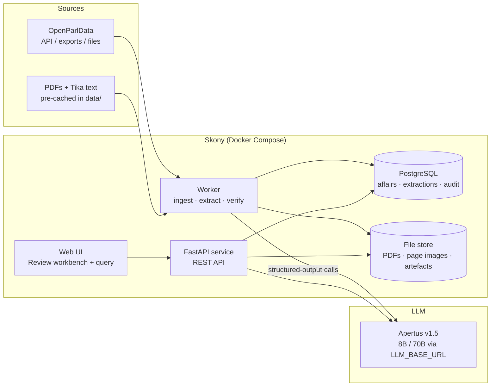
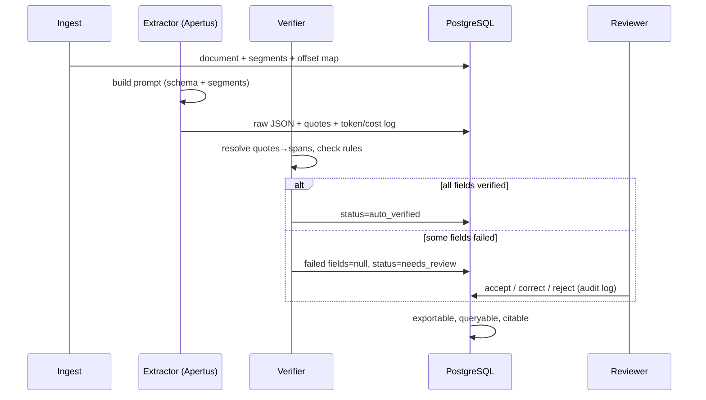

# 02 — System Architecture

> Historical design specification. The [current project direction](16-project-direction.md)
> and [delivery backlog](18-delivery-backlog.md) supersede conflicting scope,
> rubric, schema, sample counts, commands and deployment assumptions below.
> Features here are proposals unless confirmed in the
> [implementation status](../track_2a/docs/BUILD_STATUS.md). Source location
> does not establish semantic correctness or human approval.

## Design goals

1. **Trustworthy by construction** — provenance and verification are pipeline stages, not UI decorations.
2. **Production-fit** — mirrors OpenParlData's reference stack (Python, FastAPI, Pydantic, PostgreSQL) so the challenge output can go into real operation.
3. **One command** — `make run` with Docker on a clean checkout; demo fully offline on pre-cached data.
4. **Sovereign** — Apertus-only LLM access via `LLM_NAME` / `LLM_BASE_URL` / `LLM_API_KEY`; self-hostable on ~20 GB RAM.

## Container view



## Components

### 1. Ingestion service (worker, `src/ingest/`)
- Imports affairs + documents from OpenParlData API/exports or the local `data/` corpus (SK-A1).
- Runs type detection (SK-A2), language detection (SK-A3), layout segmentation (SK-A4).
- Persists raw text **with a page/offset map** — the foundation of all provenance.
- Idempotent: keyed by OpenParlData document ID + content hash; safe to re-run.

### 2. Extraction engine (worker, `src/extract/`)
- Prompt builder: system prompt + affair-type prompt + segmented document text + JSON schema.
- Apertus client: single module (`src/llm/client.py`), OpenAI-compatible chat API, reads `LLM_*` env vars, retries with backoff, logs tokens/latency.
- Output repair loop: schema-invalid JSON gets one repair attempt with the validation error fed back; still invalid → document to review queue.

### 3. Verifier (`src/verify/`) — the trust core
Pure, deterministic, unit-tested. No LLM inside.
- Resolves each field's `quote` to a `(page, span)` via staged matching: exact → normalised → fuzzy.
- Sets provenance, per-field confidence, and abstention flags (SK-B3, SK-B4).
- Runs consistency rules (dates ordered, decision implies answer present, vocab membership) — same rules as the standalone validator (SK-E3).

### 4. Store (PostgreSQL + file store)
- PostgreSQL: affairs, documents, segments, extractions (JSONB, schema-versioned), provenance spans, review actions (append-only audit log), gold set, metrics.
- File store: PDFs, rendered page images (for the UI), Docling artefacts, batch run reports.

### 5. API (FastAPI, `src/api/`)
- Everything the UI and external consumers need (see [05-api](05-api.md)).
- Pydantic models shared verbatim with the extractor and validator — one source of truth.

### 6. Web UI (`src/ui/`)
- Review workbench: compare view, click-to-source, accept/correct, queue (SK-C1..C6).
- Query interface with cited answers (SK-D1..D3).
- Small React (or server-rendered) app; must not block the demo — API + a scripted CLI demo exist as fallback.

### 7. Evaluation harness (`src/eval/`)
- Gold-set tooling and `make eval` metrics run (SK-E1, SK-E2); emits the tables for README/technical report.

## Data flow — one document end to end



## Repository layout (inside the kept `track_2a/` directory)

```
track_2a/
├── README.md               # challenge + submission info (from template)
├── technical_report.md     # architecture, evaluation, limitations
├── Makefile                # make run / make eval / make test
├── docker-compose.yml
├── Dockerfile
├── LICENSE                 # Apache-2.0
├── src/
│   ├── llm/client.py       # the only LLM gateway (LLM_* env vars)
│   ├── ingest/             # import, detect, segment, offset maps
│   ├── extract/            # prompts, schema, repair loop
│   ├── verify/             # span resolution, rules, confidence
│   ├── api/                # FastAPI app
│   ├── ui/                 # review workbench + query UI
│   ├── eval/               # gold-set tooling, metrics
│   └── schema/             # Pydantic models + vocabularies (versioned)
├── data/                   # ≤100 MB: demo corpus + gold set
│   ├── corpus/
│   └── gold/
└── docs/                   # this documentation set, diagrams
```

## Key technology choices

| Choice | Rationale |
|---|---|
| Python + FastAPI + Pydantic | OpenParlData production stack → real adoptability; one schema source of truth |
| PostgreSQL (+JSONB) | Already their stack; JSONB fits versioned extraction payloads; full-text for queries |
| Apertus 8B / 70B | Event mandate; 8B local iteration on a 20 GB VPS, 70B via CSCS/Phoeniqs for quality runs |
| Docling (optional stage) | Good structure extraction, explicitly referenced by the challenge; kept behind an interface so it is swappable |
| Docker Compose | `make run` requirement; judges run exactly this |
| Tesseract (OCR fallback) | Open source, runs in-container, keeps scanned docs in scope without external services |

## Configuration

All runtime config via environment variables (12-factor):

| Variable | Meaning | Example |
|---|---|---|
| `LLM_NAME` | model name/version | `Apertus-v1.5-70B` |
| `LLM_BASE_URL` | OpenAI-compatible endpoint | `http://llm:8000/v1` or CSCS/Phoeniqs URL |
| `LLM_API_KEY` | API key (or `local` for self-hosted) | `…` |
| `DATABASE_URL` | PostgreSQL DSN | `postgresql://skony:skony@db:5432/skony` |
| `SKONY_DATA_DIR` | corpus/artefact root | `/data` |
| `SKONY_CONFIDENCE_THRESHOLD` | auto-accept threshold | `0.85` |
