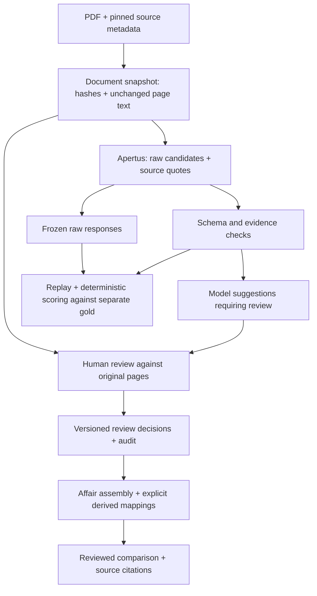

# Skony: project direction and technical contract

**Decision date:** 15 October 2026, Asia/Karachi.
**Entry:** Hack Apertus online, Track 2A / OpenParlData.
**Submission:** 16 October 2026, 12:00 CEST = **15:00 Pakistan time**.
**Current state:** working extraction/review prototype; submission and evaluation gates remain open.

**Product extension requested on 16 October:** a read-only research explorer now
exposes the converter's practical output through source-text search, multilingual
topic keyword hints, metadata dossiers, requests/answers/decisions, dated events,
signatory discovery and cited JSON/CSV briefs. This adds researcher-facing utility
while keeping the representation, provenance and evaluation deliverables above.
It does not infer official status, Q/A pairings or human approvals. See
[implemented behavior and limits](../track_2a/docs/EXPLORER.md).

**Implementation update:** full-request caching, checkpointed batch extraction,
cached-result import, gold-export safeguards, Docker packaging and replay/live
modes now exist. **245 Python tests and 16 interface tests** and clean-source startup/preview/persistence
pass. An approved real DE/FR pair replayed with identical results and zero model
calls. Actual Docker execution and frozen human-reviewed evaluation remain
pending. [Evidence and limits](../track_2a/docs/PIPELINE_VERIFICATION.md).

This is the authoritative direction for the online submission. It supersedes
conflicting implementation plans, sample counts, schedules and claims in earlier
documents. The [delivery backlog](18-delivery-backlog.md) defines completion;
the [source register](17-source-register.md) records evidence and access limits.
The [earlier assessment](15-hack-apertus-complete-assessment.md) retains the
original supplied text and links.

## 1. The project to build

**Skony turns parliamentary requests and government responses into comparable
affair records, with a source passage behind every extracted value and an
explicit account of what the system cannot establish.**

The research question is: **Which parts of a request/answer record retain the
same meaning across the sampled parliaments, languages and government levels?**

The product is a reusable converter, representation and evaluation package.
The existing review interface demonstrates those components. Its strongest
technical contribution should be the separation between a plausible model
answer, a located quotation, a semantically correct field and a human decision.

This direction fits both the official challenge and the code already present.
OpenParlData judges insight and applicability across heterogeneous sources;
well-supported partial findings are acceptable. Its three contributions are a
representation, an Apertus converter with provenance, and multilingual,
multi-level evidence including a cross-parliamentary question. [Challenge][OP]

No source establishes a guaranteed winning architecture or a probability of
winning. The priorities here are our engineering decisions based on that brief.

## 2. Why stay with this Track 2A challenge

| Challenge | What its technical task rewards | Decision for this project |
|---|---|---|
| OpenParlData | A common affair representation, faithful extraction, traceability and evaluated applicability. | **Selected.** Existing schema, verifier and review store are a useful starting point. |
| OST voting booklets | Document-grounded entailment classification, evidence and context efficiency; its Q&A specifies a separate prediction/container contract. | Borrow careful evidence evaluation. Building its NLI benchmark would be a different submission. |
| UZH SwissGov-RSD | Token-level cross-language semantic-difference scores, evaluated against its own benchmark. | Borrow strict separation of development/test material. Its token task is outside the selected scope. |
| ZHAW robot grounding | Image/instruction to target coordinates and an executable plan or appropriate refusal. | Borrow validation of outputs and honest failure cases. Robot scenes do not evaluate parliamentary extraction. |
| FHGR interview coach | Adaptive, constructive interviews under its own model/hardware/call limits. | Separate product, data and deployment requirements. No pivot from the current implementation. |

The five original briefs and seven supplied PDFs are indexed in the source
register. Requirements belonging to one challenge must not migrate into another.
In particular, the OST thresholds/proxy/registry, FHGR VRAM limit and ZHAW
video/slides requirements are not OpenParlData gates.

The OpenParlData 8 October Q&A supports starting with affairs that already have
documents, concentrating on submitted text and executive answers. It leaves
serialization open and identifies missing document roles and procedural
harmonization as unresolved design issues. [Archived Q&A][QA]

## 3. Eligibility and submission contract

Labels below distinguish **official participation/submission rules**, **challenge
deliverables**, and **internal quality gates**. A pending personal fact is not a
finding of ineligibility.

| ID | Requirement | Authority | Status at this review |
|---|---|---|---|
| E01 | Every participant is 18+; check the event overview's applicable age-of-majority condition too. | [Devpost overview][EVENT] / [rules][RULES] | Individual age not established. |
| E02 | Published excluded locations: Brazil, Crimea, Cuba, Iran, North Korea, Quebec and Russia. | [Rules][RULES] | Pakistan is not listed; each member's actual eligibility still needs confirmation. |
| E03 | Teams may contain 1-5 people. Academic affiliation is not a general entry requirement. | [FAQ][FAQ] | Solo allowed; membership and registration not independently verified. |
| E04 | Use the Devpost registration identity consistently. AI coding assistants are allowed. | [Guide][GUIDE] / [FAQ][FAQ] | Registration must be checked by the team. Compute eligibility is separate. |
| S01 | Apertus 1.5 drives the submitted solution; disclose supporting open-weight development models and roles. | [Track template][TRACK] / [FAQ][FAQ] | Current client and recorded pilot use Apertus 1.5; retain exact model/provider records. |
| S02 | Keep `track_2a/` as the selected project directory; make Docker execution work from that project root. | [Repository template][TEMPLATE] / [Track template][TRACK] | Docker/Compose/Makefiles present; actual container build/run still unverified. |
| S03 | Publish the reference repository with converter, Apertus prompts, validator and README samples. | [Live selected form][SUBMIT] | No public repository established by this review. |
| S04 | Submit a technical report PDF of at most six pages. | [Live selected form][SUBMIT] | Honest Markdown draft exists; final PDF absent. |
| S05 | Keep selected `data/` at or below 100 MB and declare runtime, hardware, keys and weights. | [Track template][TRACK] | Data below cap; runtime guide and public synthetic practice fixture added. Real sample/replay/evaluation package pending. |
| S06 | Apply the event licences and document third-party publication rights and attributions. | [Terms, section 6][TERMS] | Apache code licence present; pilot redistribution basis unresolved. |
| S07 | Submit once per project through the organiser website before the deadline. | [Live selected form][SUBMIT] | Not submitted by this work. |
| D1 | Explain a versioned representation and vocabulary, including limits of harmonization. | [Challenge][OP] / [presentation][SLIDES] | Raw document schema exists; shared affair layer pending. |
| D2 | Convert real PDFs using Apertus, with traceable extracted values. | [Challenge][OP] / [presentation][SLIDES] | Implemented for a bounded text slice; broaden and measure. |
| D3 | Evaluate against human-checked multilingual/multi-level evidence and answer a cross-parliamentary question. | [Presentation][SLIDES] | Reviewed corpus, scorer and cited comparison pending. |

The selected live form also asks for first/last name, Devpost email, GitHub
username, team name/members, project name, Swiss-student-team status and model.
Hugging Face username and a message are optional. Terms acceptance is required.
No video, five-slide deck or registry URL field appeared for OpenParlData.
[Submission form][SUBMIT]

The event defaults are Apache-2.0 for code/weights, CC-BY-4.0 for non-code
materials and CDLA-Permissive-2.0 for submitted datasets. State item-level rights;
an annotation licence cannot override source-document rights. Registration and
publication warranties remain team responsibilities. [Terms][TERMS]

## 4. What actually exists

Inspected implementation: [schema](../track_2a/src/skony/schema.py),
[pipeline](../track_2a/src/skony/pipeline.py),
[verifier](../track_2a/src/skony/verify.py),
[review store](../track_2a/src/skony/review.py),
[server](../track_2a/src/skony/server.py) and
[prompt](../track_2a/src/prompts/extract.txt).

| Area | Observed capability | Boundary |
|---|---|---|
| Intake | File SHA-256, per-page extracted text, textless-page flags. | 25 MiB/file, 1-60 pages; extraction prompt rejects more than 50,000 characters. No silent truncation. |
| Model | Configured chat-completions client, JSON-schema request, completion/model checks, token accounting. | Schema guidance is not proof of semantic correctness or universal provider support. |
| Representation | Eight raw fields under `skony.raw.v0.1`. | Document-level, single-page evidence; no shared affair assembly or vocabulary mapping. |
| Verification | Exact/whitespace-only quote lookup, original offsets, ambiguity rejection and a limited corrupt-name heuristic. | No general OCR correction, date-role classifier or semantic entailment proof. |
| Review | PDF preview, source highlights, confirm/correct/absence/undo, SQLite persistence, revision checks and audit history. | Reviewer names are self-entered; no authenticated multi-user workflow. |
| Export | Explicit reviewer decisions only, with an unreviewed-fields list. | A partial export is not automatically a complete gold annotation. |
| Testing | **82 engineering tests passed on 15 October 2026.** | Tests use fixtures/mocks/local routes; they do not measure corpus extraction accuracy. |
| Live evidence | Older two-page German Nidau pilot plus an approved DE/FR batch/cache proof: 2 calls, 2 replay hits, 0 replay calls; raw responses retained privately. | Bounded engineering proof; no statistical model comparison or semantic accuracy claim. |
| Batch/review | Full-request atomic cache, visible per-row failures, checkpoints/resume, saved-result import and guarded gold export. All 44 downloaded corpus PDFs match pinned hashes. | One failed download retained; 13 language metadata values unknown; roles need human checking. Existing 12 field decisions are not a frozen gold set. |
| Packaging/evaluation | Docker/Compose/Makefiles, replay/live modes, public synthetic fixture, clean-source check and isolated Docker verifier. | Docker/WSL unavailable; container execution, frozen gold, scoring and public submission package pending. |

The test run used the existing Python 3.11 installation. A first attempt with
the bundled interpreter lacked application dependencies; the sandbox also
blocked three loopback HTTP checks. The complete suite passed with local
networking permitted. Neither issue is an extraction-quality result.

The pilot's four located fields include a printed date placed in the submission
date slot. It must remain a semantic-review example until checked, rather than
being counted as a correct submission date. Recorded latency/token observations
are individual calls, not a benchmark. [Pilot account](12-cscs-pilot.md)

## 5. The technical design to complete

This section specifies the **target design**. Its runtime/replay foundation is
partly implemented as recorded above; remaining components are not claimed to
run. Retain the current Python/Pydantic/SQLite/static-web implementation.

### 5.1 Separate documents, affairs and claims

An affair is not a PDF. One affair may have a request, multiple answers, an annex
and a decision. One document may contain several roles.

The minimal shared layer should contain:

| Object | Contract |
|---|---|
| `AffairRecord` | Schema version; source body/affair IDs with their namespace; document links; scoped completeness; reviewed fields; derived values in a separate section. |
| `SourceDocument` | Source document ID and URL, actual byte SHA-256, ordered pages/text digest, parser/version, retrieval time and rights basis. |
| `DocumentRole` | `submission`, `executive_response`, `combined`, `decision`, `annex` or `unknown`; role origin is metadata, human or model hypothesis. |
| `RawField` | Original wording, field meaning, source references, extraction state and model run ID. |
| `DerivedField` | Normalized value, raw input references, mapping/version, body context, transformation reason and review state. |
| `ReviewDecision` | Document/revision, reviewer label, decision, value, evidence method, note, time and before/after audit references. |
| `Completeness` | Which documents/pages/fields were checked, unsupported material and whether an answer may exist outside the sample. |

Use supplied affair IDs for joins. Preserve provider `body_id` and export
`body_key` separately; the pilot demonstrates they need not be equal. A file
server path hash is an opaque source identifier unless its digest semantics are
documented. The pilot's path hash differs from the computed PDF SHA-256; that
alone does not establish corruption. The computed byte digest identifies the
actual pinned input.

For unlinked uploads, retain a document record with `affair_id = null`. Never
invent an official affair ID or merge records using topic/name similarity alone.
Start the measured corpus with confirmed metadata links.

### 5.2 Preserve the meaning of missing data

Replace a single undifferentiated null in the shared layer with a null plus
reason. At minimum distinguish:

- Not extracted or failed before extraction.
- Model abstained, with no established reason about source contents.
- Human checked and absent **in the reviewed document scope**.
- Present but unreadable or semantically ambiguous.
- Potentially/present in another linked document, with that link when known.
- Unsupported multi-page content or document type.

An answer missing from a submission PDF does not mean the government never
answered. An executive recommendation is not a parliamentary decision. A printed
date is not automatically the submission date. Absence requires reviewed scope.

### 5.3 Link requests and answers without flattening meaning

Join source documents by the verified source affair key. Retain document roles
and independent citations for the request and executive answer. If document
roles are uncertain, preserve `unknown` and queue review.

Same-affair membership establishes a document grouping, not correspondence
between every numbered question and every answer paragraph. Claim numbered
question/answer alignment only when separately checked. Do not collapse several
executive responses into one invented composite answer.

Demonstrate at least three checked request/response pairs if available. This is
an internal target; record the actual pair count and any incomplete affairs.

### 5.4 Normalize with versioned mappings

Begin with a small, body-aware mapping of observed affair labels. Preserve
`affair_type_raw`; record a derived category, vocabulary version and rationale.
DE/FR words that look equivalent must not silently erase differences in powers
or procedure. An unknown label remains unmapped.

Normalize a date to ISO only after its semantic role is established and its
interpretation is unambiguous. Keep the original spelling and precision. Do not
add missing day/month information.

Actor roles, procedure and decision outcomes need explicit scope statements.
For this release, preserve raw labels/events where their equivalence has not
been established; a small documented vocabulary may remain experimental. Add a
crosswalk explaining possible correspondence to existing standards, without
claiming complete Akoma Ntoso, Parla-CLARIN, Popolo or eCH conformance.

### 5.5 Keep source verification separate from semantic acceptance

Required invariants:

1. A non-null extracted field has document/page evidence and, for text evidence,
   a checked quote and offsets into the pinned text.
2. Evidence identifies the text snapshot as well as the PDF. Parser changes can
   change offsets even if the PDF hash is unchanged.
3. A quotation being found never changes a suggestion to human approved.
4. Extracted, metadata, normalized and manually transcribed values retain their
   different origins.
5. Visual transcription records a page and note; it never invents OCR offsets.
6. Model reruns preserve prior human decisions and their associated source/run.
7. A review changes state through an audited revision check; stale writes fail.
8. A comparison uses reviewed fields and reveals incomplete/missing coverage.

Retain exact/whitespace-only matching. Fuzzy correction of names, punctuation or
negation is unsuitable for declaring verbatim provenance. Semantic checks can
flag suspicious dates/roles, but should return reasons for review rather than
claiming that a heuristic proves correctness.

### 5.6 Handle long answers honestly

The current candidate schema represents one page/quote. For the online release,
prefer pairs whose essential texts fit that supported representation. Detect
or review continuations and mark them unsupported/incomplete; they stay in the
evaluation failure/coverage counts.

An ordered `segments[]` representation with several page references is the
next extension if the frozen corpus needs it and there is time to validate it.
Join segments only with an explicit display rule; preserve segment boundaries
and quotations. Never silently export the first paragraph as a complete answer.

Tables, figures and annexes should remain linked to their original document and
declared unsupported where appropriate. Skipping them is a disclosed limitation
of this partial prototype, not a claim to satisfy the full long-term vision.

### 5.7 Make model execution reproducible

Use a batch runner with persistent raw-response caching, resume and a per-document
status ledger. A failed PDF/API/schema response produces a failure record; it
must not disappear from the run manifest.

The pasted key `doc_hash + prompt_version + model` is a starting idea but misses
inputs that can change a response. Compute the key from a canonical, secret-free
request identity containing:

- Actual PDF and ordered page-text hashes.
- Exact effective messages/prompt bytes, not only a manually bumped name.
- Candidate schema hash and generation parameters, including token limits.
- Model name and provider/base URL identity; model revision when supplied.
- Preprocessing/parser configuration where it affects the request.

Keep credentials out of the key, metadata, browser and published cache. Provider
model aliases can change without a versioned revision; disclose that limitation.
Cache successful raw responses atomically and retain their digest, usage and
original timing. Log failures separately and allow an explicit retry policy.

Derive located results from `(raw-response hash, text hash, verifier version)`.
Changing the verifier should reuse the raw response but rebuild verification.
Changing the prompt, schema, effective text or model should invalidate generation
reuse. Never relabel an old response with today's generating prompt version;
`verify_response` now accepts recorded generating metadata explicitly. Batch
replay preserves it while applying the current verifier.

**Replay has no live fallback.** A missing/corrupt cache entry fails visibly.
Test that a second identical batch makes zero model HTTP calls, that different
inputs invalidate reuse, and that corruption cannot be treated as a valid hit.
Temperature zero is not a promise of identical fresh model generations; frozen
responses make replay/scoring deterministic.

### 5.8 Keep the runtime practical

Ship one application container with the pinned Python dependencies and Poppler.
Bind inside the container deliberately, publish only the intended localhost
port, and retain Host/Origin/request-token checks. Do not remove these checks
just to make container access work.

Keep review state in persistent storage. Rebuilding application files should
update the program while preserving uploaded PDFs, human decisions and audit
records. Keep writable state separate from read-only seed evidence/gold data.

The template's `make run` must work in `track_2a/`; a root forwarding Makefile
can remove ambiguity for reviewers. Build/pull may require network access. Our
recommended recorded-output demo should require no model key or inference
network **after the image and fixtures exist**. That replay experience is an
internal reliability decision, not a published demand for air-gapped inference.

Live mode uses `LLM_NAME`, `LLM_BASE_URL`, `LLM_API_KEY`. Only add `SKONY_MODE`
and data-directory configuration only with tested support. They are now supported
for the server; general real-response caching/replay is still pending. Preserve
an explicit opt-in for live calls.
The tested default is official `swiss-ai/Apertus-v1.5-70B`; no silent model
fallback. Model openness does not prove endpoint location or local hosting.

## 6. Evaluation that can support the contribution

### 6.1 Corpus and gold annotations

Target **12-16 fully human-reviewed documents**, at least three bodies, DE and
FR, two government levels, both request/answer roles and at least three difficult
scan/OCR cases where available. Use at least three matched affairs. These are
internal breadth targets, not official counts or sufficient proof of generality.

Keep a separate small development slice. Split by affair group, including
duplicates, translated versions and all linked documents, rather than only by
filename. Freeze the sampling manifest and exclusions before comparisons.

Use the existing workbench. For a document to enter gold, every in-scope field
must have a reviewed value or a reviewed reasoned null; unreviewed exports are
ineligible. Review against the PDF page, not only OCR or model suggestions.
Record annotation guidance, language competence, disagreements and unresolved
labels. Ideally label held-out fields before seeing predictions; if review is
assisted by suggestions, disclose that anchoring risk and independently check a
subset. Automated UI QA decisions and AI-only annotations are not human gold.

Human review is the critical dependency. Software can prepare/validate labels;
it cannot create a claim that a person reviewed them. If DE/FR review competence
is unavailable, the limitation must remain visible rather than being disguised
as a completed multilingual evaluation.

### 6.2 Compare methods on the same frozen inputs

| Method | Purpose |
|---|---|
| B0: simple Apertus extraction prompt | A fair bounded baseline asking for the same eight fields in JSON, without the production schema/evidence constraints. Preserve all failures. |
| B1: production structured prompt | Isolate the effect of the structured request on schema validity and semantic extraction. |
| B2: B1 plus deterministic verifier | Reuse **the same raw B1 response** to measure the verifier's effect on unsupported outputs and recall. |
| Optional 8B replication | Same inputs/scorer and an explicitly recorded model change; quantify schema-valid rate rather than extrapolating from one pilot. |

Equalize the model, source pages and output budget for B0/B1 where possible.
Changing prompts and generation constraints together compares system variants;
do not attribute all gains to one isolated component. Normalize parseable
baseline fields with a declared adapter; invalid outputs count as failures.
Do not drop documents on which a method times out or fails JSON validation.

### 6.3 Metrics and denominators

| Metric | Operational definition |
|---|---|
| Schema-valid rate | Valid candidate responses / all attempted documents; separate transport, parser and schema failures. |
| Field P/R/F1 | Per-field counts over scored items. Wrong non-null values on present fields contribute FP and FN; missed present fields contribute FN; invented values on absent fields contribute FP. Correct absence is reported separately. Undefined ratios are `N/A`. |
| Free-text overlap | Deterministic token-F1 with a published tokenizer/normalization, retained as overlap rather than semantic truth. |
| Semantic correctness | Human-adjudicated correct role, meaning, negation and required boundaries among located fields; give numerator/denominator and unknown-label counts. |
| Evidence accuracy | Correct document/page and support span against checked evidence, with multiple valid spans allowed. Report span overlap separately from semantic support. |
| Coverage and abstention | Non-null suggestions and abstentions / all in-scope fields, with source absence, extraction failure and unsupported content distinguished. |
| Completeness | Whether the request/answer includes all in-scope parts; truncated answers fail even if their first quotation matches. |
| Link/role accuracy | Correct metadata affair grouping, reviewed document roles and any separately claimed numbered question/answer alignment. |
| Runtime/usage | All actual calls, tokens and elapsed time; cache hits, retries and replay time reported separately. No fabricated currency costs. |

Slice by language, body, government level, document role and scan/text quality.
Publish counts with every slice. A tiny sample warrants descriptive case-study
claims; any uncertainty estimate should respect clustering by affair. Do not
treat eight fields in one PDF as eight independent parliamentary examples.

Token-F1 can score a semantically wrong sentence highly, particularly when a
negation, actor or date role changes. It cannot by itself supply semantic P/R/F1.
With no independent semantic labels, report the available exact/overlap metrics
and mark semantic correctness unmeasured.

### 6.4 Tests that demonstrate advanced engineering

Keep the existing tests; add tests only with their corresponding implementation:

- Cache replay makes zero model HTTP calls; prompt/schema/model/text changes
  cause misses; a verifier change recomputes locally; tampered entries fail.
- Two same-affair documents assemble without losing their individual evidence;
  unrelated or unresolved records cannot be falsely paired.
- Printed date/submission date, recommendation/decision and submitter/recipient
  counterexamples remain under semantic review despite matching quotations.
- Incomplete gold, duplicate/translated affair leakage and missing run items are
  rejected by evaluation tooling.
- Scoring fixtures cover wrong present values, correct absence, unsupported scans,
  malformed output, zero denominators and incomplete answers.
- Clean packaging preserves review state across a rebuild and performs a
  recorded-output demonstration without a key or live-call fallback.

These checks demonstrate explicit contracts, data lineage, effect isolation,
failure accounting and honest semantics. Each has a concrete correctness purpose.

## 7. A demonstration that makes the contribution visible

Use a short sequence, supported by the actual reviewed corpus:

1. Show a request and its government response in one affair, retaining separate
   original-document citations.
2. Open a highlighted field and inspect the original page.
3. Show the printed-date/role confusion or another real located-but-wrong case;
   explain what the automated verifier cannot establish.
4. Show a human correction and the audit record; export reviewed data.
5. Answer a concrete comparison across at least two bodies, ideally three, using
   only reviewed records. Print the sampled-body/date/topic coverage and missing
   response status. Choose the topic after finding supported examples.
6. Regenerate the metrics from frozen responses without a model call, then show
   the common/partly-common/unsupported representation findings.

Proposed comparison columns: body, source affair ID, original title, request,
executive response or scoped absence, decision only if documented, and source
document/page/span links. A curated topic filter is labelled as curated/derived;
the displayed wording remains sourced. The query needs no generative answer.

## 8. How the reviewed examples should influence us

| Reference | Verified relevance | Transfer into Skony |
|---|---|---|
| [GovTech 2023: Parliamentary data in one place][GOVTECH] | Christian Gutknecht's participant account concerns access to heterogeneous Swiss parliamentary data. | Demonstrate a reusable representation and documented interoperability limits. It is historical context, not a ready gold standard. |
| [ASU AI + Elections, 26 February 2026][ASU] | Organizer describes document conversion with human confirmation and a source-based multilingual assistant. | Show a useful operational task and human confirmation. The example uses different models and cannot validate our Apertus results. |
| [Swiss AI Weeks Apertus winners][AIWEEKS] / [CertusAI code][CERTUS] | Organizer distinguishes the overall Zurich winner from the best-use-of-Apertus award. | A clear public-interest demo matters; verify source support instead of copying self-reported trust/compliance claims. |
| [2025 science hackathon awards][SCIENCE] | Public project descriptions, demos and a linked results write-up. | Present an experiment and reproducible evidence, with a compact end-to-end demonstration. Their outcomes are not parliamentary field benchmarks. |
| [ETH Robotics Hackathon 2025][ROBOTICS] | Working voice/vision robot demonstrations. | Demonstrate one complete workflow. The event's rubric and commercial models do not define our requirements. |
| [NorthStar institutional project page][NORTHSTAR] | HKBU documents the interview-coach project and its awards. | Correct the earlier HKU attribution; useful for FHGR inspiration, not a Skony dependency. |
| [Swiss Legal RAG demo][RAG] | Small documented retrieval/answer application; older Apertus release and a non-Apertus fallback are listed. | Study presentation simplicity. Do not transplant its model/fallback or call it compliant with the 1.5 contract. |
| [Apertus Translate][TRANSLATE] | Multilingual experiments and human evaluation material. | Adopt documented slices and human checks; its labels do not substitute for affair gold. |

The supplied Apertus testing presentation motivates checking structured output,
missing values and task-specific behavior. Its benchmark numbers must not become
Skony metrics. Fine-tuning/probes are research options only after adequate labels
and access exist; a hosted completion endpoint does not supply activations.

## 9. Changes to earlier advice and documents

| Earlier statement/assumption | Correct direction |
|---|---|
| The workbench is the main novelty. | The provider already has one. Demonstrate reusable semantics and measured evidence. |
| Track 2B's five criteria are our scoring rubric. | OpenParlData's own insight/applicability criteria govern this entry. |
| Full RDF/XML, all actor/procedure features or complete OCR are prerequisites. | The Q&A permits a bounded investigation. Describe unsupported scope and retain original content. |
| More infrastructure shows more technical ability. | Keep the working stack; prove identity, lineage, semantics, reproducibility and failure handling. |
| A located quote is a correct extraction. | Source location and correct role/meaning/completeness are separate measures. |
| Token-F1 is semantic correctness. | It measures overlap; semantic evaluation needs defined checked labels. |
| Twelve, twenty or fifty documents are official minima. | No fixed OpenParlData count was found. Report actual breadth and limits. |
| Any reviewed-only export is gold. | All in-scope fields need human decisions; incomplete/automated QA exports are excluded. |
| A basic three-part cache key guarantees replay correctness. | Fingerprint effective input/request identity; version derived verification separately. |
| A fresh temperature-zero run is deterministic. | Frozen-output replay is deterministic; fresh hosted generation may vary. |
| 8B is proven inferior to 70B. | Current evidence is one pilot with different failed/successful attempts, not a controlled study. |
| Earlier plans claimed mode settings, confidence threshold, Docker and local 8B were already available. | Mode/data-dir support and Docker files now exist; container verification, calibrated confidence and a local 8B profile remain unverified/unimplemented. |
| The judge must have no network even to build. | Docker execution is official. Our no-key replay is an internal quality goal after packaging. |
| A duplicate local env file proves disclosure and mandates rotation. | Keep private files out of publication; no credential disclosure was established by this review. |
| The historical root report's placeholders can ship. | Use the active Track 2A report; retain the old draft only as labelled archive. |

## 10. Scope and completion order

**Complete first:** Docker/clean execution and public sample packaging; cache and
batch ledger; human-reviewed corpus; affair grouping/roles and small derived
vocabulary; fair scoring and baseline; cited cross-body answer; final report and
public submission package. Human annotation and implementation can interleave.

**Add only after those gates:** ordered multi-page spans when necessary for the
selected corpus, a controlled 8B replication, and a small standards crosswalk.

**Future work:** free-form RAG/chat, broad OCR/layout support, learned confidence
calibration, fine-tuning, activation probes, graph serialization, production API
adapters, database migration, authentication and a full four-language corpus.

The release is complete when the [backlog's evidence gates](18-delivery-backlog.md)
are satisfied or explicitly reported as limitations. A missing submission
artifact remains a blocker; it cannot be relabelled as future work. The honest
final feasibility conclusion may be partial, but must follow measured evidence.

[EVENT]: https://hackapertus.devpost.com/
[RULES]: https://hackapertus.devpost.com/rules
[FAQ]: https://hackapertus.ch/faq#online-hackathon
[GUIDE]: https://hackapertus.notion.site/getting-started-guide-onlinehack
[TRACK]: https://github.com/HackApertus/project-template/blob/main/track_2a/README.md
[TEMPLATE]: https://github.com/HackApertus/project-template
[TERMS]: https://hackapertus.ch/terms-and-conditions
[SUBMIT]: https://hackapertus.ch/online-hack/submissions
[OP]: https://hackapertus.notion.site/track-2a-openparldata
[SLIDES]: https://hackapertus-document-extraction-26a562.gitlab.io/#/title-slide
[QA]: ../tmp/event-assessment/openparldata-qa.pdf
[GOVTECH]: https://www.glue.ch/en/2023/05/08/govtech-hackathon-parliamentary-data/
[ASU]: https://modl.spa.asu.edu/projects/first-ever-ai-elections-hackathon
[AIWEEKS]: https://www.linkedin.com/posts/eth-ai-center_over-the-past-weekend-our-ai-hackathon-activity-7378188935459659777-Brrs
[CERTUS]: https://github.com/saurluca/CertusAI
[SCIENCE]: https://llmhackathon.github.io/awards/
[ROBOTICS]: https://inf.ethz.ch/news-and-events/spotlights/infk-news-channel/2025/06/robotics-hackathon.html
[NORTHSTAR]: https://cisl.hkbu.edu.hk/triangle/Projects/ay-2024-25-cohort-2/NorthStar.html
[RAG]: https://github.com/alexchilton/apertus_demo_hf
[TRANSLATE]: https://github.com/swiss-ai/apertus-translate
