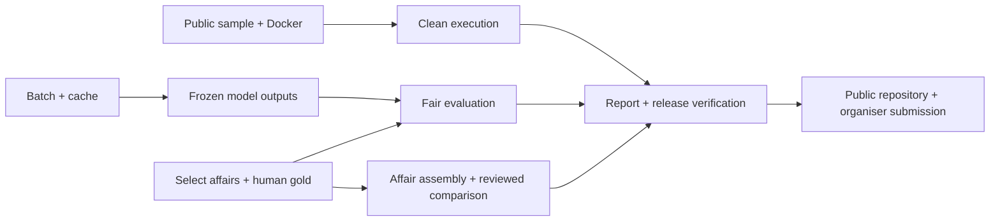

# Skony: delivery backlog and release gates

**Updated:** 15 October 2026, Asia/Karachi.
**Authority:** [project direction](16-project-direction.md).
**Deadline:** Friday 16 October, 15:00 Pakistan time / 12:00 CEST.

This is an implementation backlog, not a claim that all targets already run.
`make run` is now implemented as Docker/Compose packaging, but container execution
is unverified here. `make eval`, `make question` and the remaining proposed
automation checks are internal deliverables until implemented.
Keep the current application stack and workbench.

## 1. Critical path



Human annotation should start as soon as usable sources are selected. Do not
wait for a new annotator or UI redesign. Complete independent engineering work
while the team reviews documents; do not replace human gold with AI labels.

## 2. Ordered work packages

| ID | Priority | Deliverable and dependencies | Completion evidence | Current status |
|---|---|---|---|---|
| W01 | P0 | Select public sample(s); document item-level publication rights, URLs, source IDs, actual byte/text hashes and retrieval method. | Samples or a reliable acquisition path available to judges; no ignored private file dependency. | Authored synthetic practice fixture packaged; real parliamentary sample/response rights still pending. |
| W02 | P0 | Dockerfile, narrow build context, persistent review storage, project Makefile and repository-root forwarder. Depends on W01 for seeded demo. | Clean package starts the workbench, preview works, no key required for practice demo, rebuild preserves a review. | Files/replay and isolated Docker verifier implemented; 82 local tests and native clean-source startup/preview/restart pass. Docker/WSL absent: actual container check still pending. |
| W03 | P0 | Batch runner, canonical request fingerprint, atomic raw cache, resume and run ledger. | Second identical run makes zero model HTTP calls; altered text/prompt/schema/model misses; tamper/missing replay fails visibly. | Implemented. Approved real DE/FR pair: 2 live calls, 2 replay hits, 0 replay calls; failed download preserved. Cache/batch/import recovery tests pass. [Evidence](../track_2a/docs/PIPELINE_VERIFICATION.md). |
| W04 | P0 | Freeze development/evaluation affair groups; annotate with existing workbench. | 12-16 fully reviewed target docs, DE/FR, 3 bodies, 2 levels, hard scans and paired roles; actual counts and shortfalls disclosed. | Tooling ready; 44 hash-checked downloads plus 1 failed row. Store has 12 decisions across 4 documents, one mechanically complete; no frozen competence-checked gold set. |
| W05 | P0 | Affair wrapper, source ID namespaces, document-role provenance and checked request/answer grouping. Depends on source metadata/review. | At least 3 checked pair examples if available; unknown roles retained; unrelated affairs cannot merge. | Role hints/provenance retained and flagged for review. Shared wrapper and checked grouping pending. |
| W06 | P0 | Small versioned type/date derived layer with raw values preserved. | Body-aware mapping table; unknowns/ambiguous dates stay unresolved; scope/semantic distinctions documented. | Pending. |
| W07 | P0 | Deterministic scorer with failure accounting, gold completeness and group-leakage checks. Depends on W03/W04. | Small known-answer scoring fixtures pass; report includes denominators, all failed inputs and body/language/role slices. | Pending. |
| W08 | P0 | Fair simple baseline plus structured and verified variants on identical frozen inputs. | Raw responses/run IDs retained; B1/B2 share responses; no method silently drops failures; semantic labels distinguished from overlap. | Pending. |
| W09 | P0 | One deterministic cross-parliamentary comparison over reviewed affair records. Depends on W04/W05. | Cited rows from at least 2 bodies, ideally 3; explicit sample/topic coverage and incomplete-response labels. | Pending. |
| W10 | P0 | Technical report PDF, maximum 6 pages; README and licences; final public repo. Depends on actual results. | Report numbers traced to frozen artifacts; public clean checkout works; selected form requirements complete. | Draft only. |
| W11 | P1 | Multi-page evidence when essential to the selected corpus. | Ordered spans keep original pages; completeness tests pass. Otherwise disclose scoped unsupported cases. | Not implemented. |
| W12 | P1 | Optional controlled 8B replication or concise standards crosswalk. | Measured comparison or accurately labelled partial mapping; no one-pilot generalization. | Not implemented. |

P0 means required to make **our selected contribution** credible or submit the
package. Some P0 items are internal quality choices rather than organizer rules;
see requirement IDs E/S/D in the direction document. Time estimates in earlier
responses are planning guesses, not evidence of completion.

## 3. Proposed module boundaries

Paths below are implementation destinations. They do not exist merely because
they appear in this table. Reuse current modules wherever practical.

| Area | Existing anchor | Addition/current state |
|---|---|---|
| Request identity/cache | `src/skony/client.py`, `pipeline.py` | Implemented `cache.py`, `batch.py` and script wrapper; effective request metadata and raw response envelope. |
| Replay | `scripts/replay_pilot.py` | Implemented manifest-driven replay preserving original generating metadata; real DE/FR proof passed. |
| Affair model | `src/skony/schema.py` | Separate shared record/wrapper; retain compatibility with `skony.raw.v0.1`. |
| Source manifest | `scripts/fetch_pilot_metadata.py` | Selector/fetcher and pinned-hash intake implemented; heuristic roles remain review-required. |
| Review/gold | `src/skony/review.py` | Implemented cached import and complete-decision exporter; synthetic/QA/stale-output safeguards. Human gold validation pending. |
| Mapping | Raw type/date fields | Versioned observed-label mapping resource; explicit `derived` values. |
| Evaluation | Existing engineering tests | Scorer, gold/run manifests, checked semantic labels, generated reports. |
| Comparison | Reviewed export | Deterministic affair query and cited Markdown/table output. |
| Runtime | `server.py`, `__main__.py` | Container binding/configuration, safe host checks, seeded replay and persistent state. |

Suggested public evidence layout inside `track_2a/`:

```text
data/
  sample/             # licensed source inputs or pinned retrieval manifest
  gold/               # complete human annotations + annotation README
  replay/             # publishable raw responses and request/run manifests
docs/
  eval/               # generated scores, method comparison and failure analysis
  cross_parliamentary_answer.md
technical_report.md   # source for the final <=6-page PDF
```

Stay within 100 MB for the selected `data/` directory. Publish only responses
and source excerpts for which the rights basis is documented.

## 4. Release gates

| Gate | Required proof | State |
|---|---|---|
| G0: entry | Team age/location/registration/membership checked; OpenParlData selected; model roles disclosed. | Personal checks pending. |
| G1: run | Fresh public checkout -> `cd track_2a` -> `make run`; container opens usable seeded review; persistent decisions survive rebuild. | Partial: packaging and native clean-source checks pass; container build/run/rebuild still open. |
| G2: source | Sample and manifest accessible; byte/text hashes and rights verifiable; no local private paths required. | Open. |
| G3: replay | All selected run items accounted for; raw cache verified; repeated batch has zero model calls; failure does not trigger live fallback. | Bounded real DE/FR proof passed, including preserved failure. Repeat on the final frozen release corpus; private cache is not yet cleared for publication. |
| G4: gold | Complete human decisions, affair-disjoint split, annotation guidance and actual breadth counts. | Open. |
| G5: findings | Reproducible baseline/structured/verified results; semantic-role errors, unsupported cases and completeness visible. | Open. |
| G6: value | At least one reviewed cross-body answer with working document/page citations and scope. | Open. |
| G7: submission | Public accessible repository; final <=6-page PDF; all selected website fields complete; confirmation saved after submission. | Open. |

The **82 passing engineering tests** are a completed check, not completion of
G4 or G5. A successful local server is not G1 until its public Docker package
works cleanly. A replay demo is labelled recorded model output, not fresh
inference or local LLM hosting.

## 5. Remaining-time allocation

At roughly 04:10 PKT on 15 October, approximately 35 hours remain. These are
recommended work blocks, not claims about anybody's availability.

| Time in Pakistan | Focus | Required outcome |
|---|---|---|
| Thu morning | W01/W02/W03; begin W04 selection and review. | Runnable public seed path and first cached batch; human annotation underway. |
| Thu daytime/evening | Protect the largest block for W04; interleave W05/W06/W07. | Reviewed corpus with linked roles, mapping and a scorer ready for frozen outputs. |
| Thu evening/night | W08/W09 and failure analysis. Freeze features after the evidence pipeline works. | Real method comparison and one cited cross-body result. |
| Fri morning | W10: write findings, render/inspect <=6-page report and run clean checkout checks. | A concrete release with reproducible claims. |
| Fri 12:00-13:00 | Complete organiser submission after artifact checks. | Saved confirmation, allowing buffer before the 15:00 hard deadline. |

If annotation is slower than expected, reduce the document total honestly while
preserving meaningful language/body/role diversity. Report all target shortfalls
and narrow the claims. Drop W12, optional UI polish and W11 before sacrificing
basic source faithfulness or hiding failures. A smaller corpus does not remove
the obligation to explain its limited applicability.

## 6. Six-page report plan

Use the organizer's [report template](https://github.com/HackApertus/project-template/blob/main/track_2a/technical_report.md),
adjusted to the actual implementation. Eight sections can fit within six pages:

1. Summary and declared contribution/scope.
2. System architecture and exact Apertus/model/data flow.
3. Common representation, source identity and derived vocabularies.
4. Corpus/annotation/split/methods and measured evaluation.
5. Feasibility findings: shared, partly shared, unsupported; cite concrete cases.
6. Cross-parliamentary answer and coverage.
7. Reproduction, runtime and actual token/latency observations.
8. Limitations, ethics, licences and references.

Keep all result numbers generated or directly traceable to frozen artifacts.
Do not turn this plan's targets, external benchmark numbers, engineering test
counts or manually corrected exports into model-accuracy claims.

## 7. Required synchronization when an implementation lands

For every completed work package, update the corresponding current-status row
and evidence link in [BUILD_STATUS](../track_2a/docs/BUILD_STATUS.md), this
backlog and the active report. Change a status to complete only after its
completion evidence exists. Keep the source register's retrieval date unchanged
unless the underlying source is actually rechecked.

The authority order is: official current challenge/form/terms for rules;
[16-project-direction](16-project-direction.md) for our design;
implementation/artifacts for capabilities; and generated evaluation for results.
Historical plans cannot override any of those.
