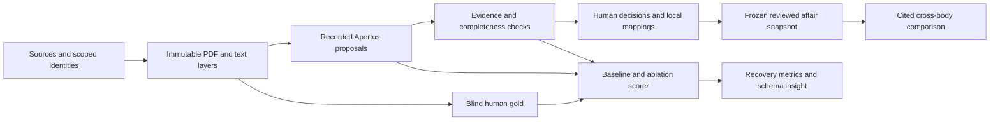

# Skony: prototype excellence implementation plan

**Prepared:** 15 October 2026, Asia/Karachi.
**Revision:** 1.1, revised after independent GPT-6-astra and GPT-6-sol audits.
**Status:** design only. No application changes, extraction runs, annotations, or measured results are created by this plan.
**Scope:** prototype functionality, representation, correctness, usefulness, evaluation, and local reproducibility. Docker, GitHub, publication, and submission operations are deliberately outside this work package.

## 1. What the finished prototype should accomplish

Skony should let an analyst take unfamiliar parliamentary PDFs, understand which affairs and procedural acts they describe, inspect the evidence, resolve uncertainty, and compare reviewed findings across parliaments without losing local meaning.

The flagship workflow is:

1. Import a bounded collection with source identities and a documented sampling scope.
2. Inspect document quality, language, affair membership, and document roles.
3. Run a recorded Apertus extraction that preserves raw wording and cites every proposed value.
4. Review an affair as a sequence of submissions, executive responses, and decisions, with independent document and question/answer links.
5. Compare selected affairs across bodies using reviewed, explicitly comparable fields.
6. Open any comparison cell at its supporting PDF passage and export the same reviewed snapshot.
7. Recalculate the benchmark and the cross-parliamentary answer from frozen local artifacts without another model call.

This is the product contract. A sophisticated pipeline is useful when it makes this workflow reliable and makes its remaining limits visible.

### What “100/100” means here

The user's 20/20/20/25/15 scorecard is an internal planning rubric. The archived official brief names **insight** and **breadth and applicability**, and explicitly accepts convincing partial or negative findings. It does not supply those numerical weights. A plan cannot guarantee a judge's score, and a prototype-only plan cannot discharge submission requirements that the user excluded.

Accordingly, the objective is **full-credit quality of prototype evidence**, with all five user categories traceable to working behavior and inspectable artifacts. Perfect extraction accuracy is neither promised nor required for an honest, strong research contribution. The target is a persuasive answer to where a common schema works, where it is conditional, and where harmonization would destroy meaning.

## 2. Starting position: verified code versus unfinished evidence

The plan follows the current implementation rather than assuming every statement in earlier status documents is current.

| Area | Observed on 15 October | Consequence for implementation |
|---|---|---|
| Raw model | Eight strict fields in CandidateExtraction; skony.raw.v0.1 | Keep a compatibility reader. Add an affair layer instead of silently changing old outputs. |
| Evidence | Exact and whitespace-only lookup, page offsets, ambiguity rejection, limited corrupt-name filtering | Extend to ordered multi-page evidence and immutable text layers. Do not relabel location as semantic proof. |
| Human workbench | PDF images, highlights, confirm/correct/absence/undo, SQLite, revision checks, audit and reviewed-only export | Extend this application. Avoid a frontend or backend rewrite merely for appearance. |
| Batch and replay | cache.py, batch.py, importer and gold exporter already exist | Harden and reuse. They are not missing greenfield components. |
| Recorded replay proof | proof.json records two live DE/FR inputs, a preserved failed row, and identical replay with zero live calls | Useful engineering evidence, not a quality benchmark. The proof was read, not rerun for this plan. |
| Candidate corpus | Manifest has 45 rows: 41 fetched, 3 cached, 1 failed; six body keys; 24 de, 8 fr, 13 unknown language labels | Validate the actual documents. Intended stratification is not established language, role, or sample quality. |
| Review store | Main store has 45 document rows, 12 field reviews, and one row with all eight reviews | Counts do not prove reviewer competence, independence, corpus suitability, or benchmark eligibility. Audit these existing decisions; preserve their history. |
| Representation and evaluation | No implemented affair model, deterministic scorer, completed systematic benchmark, or reviewed cross-body answer found in the inspected modules | These are the major remaining prototype investments. |
| Status documents | Earlier documents say 42 or 53 tests and still describe some existing modules as pending | Generate a current capability/results manifest during implementation. This plan makes no new test-pass claim. |

The candidate sources include a Vergerette fact sheet attached through source metadata. Its topic alone does not establish that it is illegitimate: a parliamentary affair may have non-parliamentary annexes. The defect to fix is ambiguous role and source interpretation, rather than simply deleting an embarrassing filename.

## 3. Rubric-to-evidence contract

| User category | Full-credit prototype objective | Required demonstrable evidence | Acceptance IDs |
|---|---|---|---|
| Relevance and usefulness, 20 | A researcher can answer a bounded question across bodies and inspect every supporting claim | Working comparison, explicit sample coverage, analyst task study, reusable reviewed exports | U1–U4, Q1–Q4 |
| Technical implementation, 20 | Reliable multi-stage extraction and review with preserved lineage | Multi-page evidence, safe OCR path, audited revisions, restart recovery, failure accounting | T1–T8 |
| Common representation and insight, 20 | A small shared core plus documented local differences | Affair/document separation, body-aware crosswalk, preserved unknowns and conflicts, feasibility matrix | R1–R6 |
| Evaluation and breadth, 25 | A fair, frozen multilingual, multi-body, multi-level study | Human gold, identical cohorts, baseline and ablations, field and relationship metrics, uncertainty and failure cases | E1–E8 |
| Reproducibility and readiness, 15 | Local artifacts reproduce every prototype number and demonstration | Pinned identities, zero-call replay, deterministic scorer/query, coherent docs, provenance and rights records | P1–P5 |

The last row addresses local prototype reproducibility. It does not claim to earn all official submission-readiness credit while container and public-delivery checks remain outside scope.

## 4. Architecture: evolve the existing modular application

Keep Python, Pydantic, SQLite, existing request handling, and the current browser workbench as the initial implementation. Put business rules in domain services, rather than embedding them in route handlers or browser state. Add bounded background execution for expensive parsing/OCR/model stages. A queue, artifacts, and immutable records are sufficient; this sample does not justify microservices, a vector database, or an autonomous multi-agent extraction system.

### Component responsibilities

| Component | Responsibility | Boundary |
|---|---|---|
| Intake and corpus service | Source registration, byte identity, scope, eligibility, language and role review | Metadata claims remain distinct from PDF-derived claims. |
| PDF/text service | Native text, page rendering, text-quality signals, optional OCR, layout anchors | Never overwrite a native text snapshot or manufacture an offset. |
| Apertus extraction service | Versioned structured proposals over bounded, identified input | No access to human test labels, arbitrary tools, or external links in document text. |
| Evidence service | Resolve candidate spans in the claimed text layer and identify completeness warnings | Location and heuristic checks cannot certify semantic correctness. |
| Representation service | Assemble affair views, assertions, local mappings, events and relationships | No similarity-only affair merge or automatic equivalence claim. |
| Review service | Independent human decisions, revisions, adjudication and stale-evidence detection | Model reruns cannot overwrite decisions. |
| Comparison service | Deterministic queries over a reviewed snapshot and compatibility rules | No unsupported inference that missing data mean no government action. |
| Evaluation service | Frozen cohort validation, scoring, error taxonomy and result artifacts | No silent removal of failures or tuning against test results. |

All stages refer to immutable artifact IDs. Mutable projections such as “latest suggestion” and “review queue” can be rebuilt from source records, runs and decisions.

### End-to-end state and failure model

A job progresses through queued, intake, text_prepared, extracted, evidence_checked, review_ready, and completed. Each stage may instead become failed, unsupported, or cancelled with a stable reason code. Review_ready is not reviewed. A partially reviewed affair is not complete simply because the extraction job finished.

Persist a job record and append stage events before and after expensive work. Use a bounded single-writer workflow initially, per-document work locks, explicit attempt IDs, and a lease/heartbeat for running jobs. On restart, mark an abandoned attempt interrupted and require explicit resume; never turn an interrupted model call into an unrecorded retry. A repeated request returns the existing job or an explicit new attempt according to its idempotency key.

Inference timeouts are ambiguous: a remote call may have completed even when the client did not receive it. Record the uncertainty and count each subsequent attempt separately. Set model-call, page, OCR-time, and output-token budgets before a batch starts.

## 5. Representation model: shared semantics without forced equivalence

### Entities and identity

| Entity | Essential content |
|---|---|
| SourceRecord | Provider namespace, original IDs, source URL, retrieval time, metadata snapshot and its digest, rights status |
| DocumentArtifact | Actual PDF SHA-256, size, page count and immutable artifact location |
| TextSnapshot | PDF digest, parser or OCR identity, configuration, ordered page-text digests, language settings, creation time |
| AffairRecord | Internal persistent ID, official identifiers when established, body identity, jurisdiction level, linked source records |
| AffairDocumentLink | Affair, source record, artifact, role, applicable page/section scope, link evidence and review state |
| Assertion | Field meaning, original wording or source-state reason, evidence segments, extraction origin and run identity |
| ActorMention | Printed name, printed role and supporting evidence; resolved external identity only if independently established |
| QuestionItem and ResponseItem | Original ordered segments, labels or numbering, source scope, explicit alignment relations |
| ProcedureEvent | Actor, date/precision, verbatim act label, references and optional derived category |
| MappingRule and DerivedAssertion | Body-scoped transformation, version, inputs, category, applicability conditions and rationale |
| ReviewDecision | Target assertion or relation, source snapshot, reviewer, action, revision, basis, time and audit lineage |
| ReviewedSnapshot | Exact accepted decisions, mapping versions, exclusions, completeness and content digest |

The present document table deduplicates on byte SHA-256 and stores a source JSON object. Extend storage so that **one artifact may have multiple source records and affair links**. Identical bytes at two source URLs must not discard provenance or merge their affairs. Conversely, two different PDFs may describe one affair. This needs a many-to-many association, not a single source field on an artifact.

Use namespaced official keys, such as provider + source-body identity + source-affair ID. Preserve body_id and export body_key separately. A source file-server path hash is an opaque identifier unless its semantics are established; it need not equal the computed PDF digest. Unlinked uploads receive an internal document identity and an unresolved affair link, never a fabricated official number.

### The shared core

The first common layer contains title, affair-type mention, actor mentions and roles, addressed body, submitted content, executive responses, dated procedural events, decision wording, and explicit relationships. Multi-value fields are arrays: co-signatories, response versions, dates and decisions cannot be flattened into one string without recording the loss.

Document roles are submission, executive_response, decision_record, minutes, annex, combined, or unknown. Roles belong to scoped links: a combined document can contain several roles, and minutes can describe multiple affairs. Affair membership, document role, and numbered question/answer alignment are three different relations with separate evidence and review.

For a multi-affair document, create scoped associations to identified affairs and assign assertions to their section ranges. Shared headers remain document-level. If segmentation is ambiguous, preserve the source, mark the affected scope unresolved, and prevent those claims from entering a reviewed affair export as though their target were known.

### Versioned extraction contract and benchmark projection

Introduce skony.candidate.v0.2 alongside the unchanged v0.1 reader. The trusted run envelope supplies artifact ID, text-snapshot ID, allowed subject/scope IDs, prompt/schema/model identities and chunk-manifest ID. Model output may refer only to those closed-set IDs or create local proposal IDs; it cannot introduce an official affair identity, file path or trusted source association.

The v0.2 response contains all eight core field slots plus optional typed structural proposals. Every slot identifies its subject/scope and is either abstained or contains an ordered list of verbatim quote segments with page/layer references. The service resolves offsets and constructs display values; model-supplied offsets, identity/role guesses and completeness claims are untrusted proposals. Separate proposals represent actor mentions, numbered questions/responses, events and relations. Structural proposals omitted from a run are explicitly not_extracted, not empty evidence of absence.

The strict top-level wire keys are schema_version and targets. Each target has a closed-set scope_id, fields, actors, question_items, response_items, events and relations. The fields object requires exactly the eight core names. Each field slot has outcome (proposed or abstained), items and abstention_reason; abstained requires an empty items list and a reason, while proposed requires at least one item and no abstention reason. Each item has a local proposal_id and nonempty ordered segments; a segment has page, layer_id and quote, with an optional exact context anchor for repeated text. All unlisted keys are forbidden. Typed structural proposals refer to local item/segment IDs and permitted endpoint types. Parser validation rejects duplicate IDs, dangling references, cross-scope ownership violations and out-of-manifest pages/layers. This is the model proposal contract; run identities, accepted values and trusted official identifiers are supplied by application services.

| Predicate or object | Subject and cardinality | Initial converter/reviewer responsibility | Benchmark projection |
|---|---|---|---|
| title | Affair-scoped document section; one primary printed title, alternatives preserved | Apertus proposes; reviewer resolves primary/alternate | Primary title in the document's target scope |
| affair_type_raw | Same subject; zero or more printed type mentions | Apertus proposes; reviewer verifies role and resolves conflict | One designated printed type or explicit unresolved disposition |
| submitter_raw and ActorMention | Submission scope; one original submitter block, zero or more actor mentions | Core converter extracts the block; typed actor parsing is a separate named capability and review step | Whole printed submitter block; actor-list metrics are separate |
| submitted_date_raw | Submission event in that scope; zero or more dated assertions | Apertus proposes date and role; human confirms the designated submission event | Designated submission date, retaining unresolved alternatives |
| question_text | Submission scope; ordered demand/question segments and optional numbered items | Converter proposes source sections; human verifies boundaries and itemization | Full designated submitted demand/question block, not a summary |
| answer_text | Specific executive-response document/section; ordered segments and optional response items | Converter proposes; human verifies scope and completeness | This document's response block; several response versions never collapse into one field |
| decision_raw and decision_date_raw | Parliamentary decision event in scope; zero or more distinct events | Converter proposes; human distinguishes executive recommendation and parliamentary act | Designated in-scope decision/date; multiple unresolved decisions are labelled rather than arbitrarily selected |
| addressed body, co-signatories and related-affair links | Typed mentions or relations; zero or more | Preserve as reviewed structural claims when actually extracted; otherwise untested | Outside the initial eight-field score; separate metrics required before claiming automated accuracy |

Typed relation endpoints are closed by relation kind: affair_document links an AffairRecord to an AffairDocumentLink; question_response links a QuestionItem to a ResponseItem; response_decision links a ResponseItem to a ProcedureEvent of reviewed decision kind; related_affair links two AffairRecords and records the printed relation label. Each relation retains evidence/origin and uncertainty. Same-affair grouping alone never creates the other relations.

Three required contract examples accompany the implementation:

- **Multi-page answer:** one response assertion has segment R1 on page 2 and continuation R2 on page 3, both tied to the same text snapshot. The display rule joins R1 then R2; boundary/completeness remains unknown until checked. The v0.1 single-page evidence export rejects this value as unrepresentable rather than dropping R2.
- **Two submitters:** the original submitter block remains one source-backed core field; separate actor mentions point into that block and preserve their printed roles. A typed actor export retains both. A legacy aggregate string may be displayed as such but cannot be presented as a typed actor list.
- **Minutes with two affairs:** one artifact has scoped links S1 and S2 to independently verified affair identities. Each assertion and decision belongs to one scope, or is marked shared/unresolved. Evaluation units are document-plus-target-scope, clustered under the artifact and affair group, rather than one flattened document label. A legacy single-affair export must select an explicit target or refuse the conversion.

Maintain a projection policy version and reject lossy “compatible” exports. A human-readable lossy summary is allowed only when explicitly labelled and excluded from raw benchmark scoring. Freeze field slots, multiplicity and the target-scope policy before W4; report both artifact count and scoped evaluation-unit count.

### Field state has independent dimensions

Avoid one overloaded status enum. Store:

1. **Source assessment:** present, absent_in_reviewed_scope, unreadable, ambiguous, outside_available_scope, or not_assessed.
2. **Extraction outcome:** proposed, abstained, failed, unsupported, or not_run.
3. **Evidence outcome:** located, ambiguous_location, not_located, image_only, or not_applicable.
4. **Human decision:** unreviewed, accepted, corrected, rejected, or adjudication_required.

A model's null only means abstained. It does not establish absence. A human may find a visually readable value that the model could not extract. An answer absent from an imported submission is absent in that document scope; its existence elsewhere remains unknown.

Completeness must carry reviewed document/page scope, missing expected roles, unreviewed linked material and unsupported structures. It must distinguish “all eight field dispositions recorded” from “all parliamentary source material available.”

### Provenance and multi-page values

Every extracted non-null assertion references one or more ordered evidence segments. A segment identifies PDF digest, text snapshot, page, text layer, half-open start/end offsets, exact stored quotation and optional page coordinates. A question or answer may contain multiple segments and explicitly marked gaps.

The displayed verbatim value is assembled deterministically from ordered source segments, with a versioned separator rule. It is not a model-authored paraphrase. A summary, translation or normalized date is a separate derived assertion with references to its inputs.

Offsets use Unicode code points into the immutable page text. Browser highlighting must explicitly convert to JavaScript's UTF-16 indices where needed. Test supplementary characters, combining marks, repeated text and page breaks. A page image anchor records render dimensions and coordinate transform; do not guess bounding boxes from plain text offsets.

Image-based human transcription records page, region when known, transcript and review note, but carries no claimed native/OCR character offset. An OCR span is verbatim relative to its OCR snapshot, not a guarantee that recognition matches the PDF image.

### Controlled vocabulary and local meanings

Create small versioned vocabularies for coarse affair families, actor roles, document roles, event classes and decision outcome families. Coarse families support navigation; they do not assert equal legal force. Keep the printed term, its body, jurisdiction and available procedure context.

Each mapping rule records source label, source body, validity interval when known, destination concept, relation (exact_in_scope, broader, narrower, related, or unmapped), rationale, supporting reference, author/reviewer and version. Unknown labels remain unmapped. Do not use a global German/French dictionary as proof of procedural equivalence.

An executive recommendation to adopt something is an executive event, not a parliamentary adoption. A refusal to transmit a motion differs from rejecting its substantive demand. Preserve these distinctions even if a broad comparison groups both under a locally qualified outcome family.

Dates carry their semantic role and precision. Normalize only unambiguous readings; a year stays a year. A printed header date cannot become a submission date without supporting context. Conflicting values remain multiple assertions with a conflict flag and resolution history.

### Standards crosswalk

Provide a concept crosswalk with columns for Skony concept, candidate external counterpart, supported information, losses, and implementation status. The initial targets are Docling for structural anchors, Popolo for actors/organizations, Akoma Ntoso for document/metadata relationships, and Parla-CLARIN for any future debate-oriented material. These are distinct scopes; not all are useful export formats for this prototype.

Treat the evolving eCH political-affairs work as a reference to monitor during implementation, not a claimed conformance target. A documented mapping is not a standards-compliant serializer. A future serializer earns that claim only after its actual output passes the relevant validation and round-trip checks.

## 6. Extraction and verification functionality

### Corpus gate and attachment hygiene

Before extraction, the workbench presents source body, affair key, metadata title, PDF first-page preview, candidate role, detected/confirmed language, and source rights status. Require a reasoned role decision for core benchmark documents.

Classify material as core_parliamentary, supporting_annex, unrelated_or_mislinked, or unresolved. A plant or water fact sheet may be a valid supporting annex. Keep it linked when supported; exclude it from the core eight-field benchmark through a predeclared role policy, and include it in a separately reported attachment-handling challenge set. If a source association is wrong, record the discrepancy instead of erasing the evidence.

Predefine eligibility before inspecting method performance. Preserve a selection flow with all candidate rows, source failures, exclusions, reasons and replacements. Once the test cohort is frozen, a hard document stays in the cohort. No “easy replacement” after a model fails.

### Native text, OCR and structure

Keep pypdf as the native-text path. Use existing page rendering for inspection. Add an optional local OCR adapter with pinned engine, language-pack/configuration identities, resource limits and immutable output snapshots. Select pages based on textlessness and documented quality heuristics, not merely a source's likely_scanned flag.

Keep native and OCR text side by side. Record the selection policy and quality warnings; do not silently choose whichever layer produces the desired answer. Scanned pages with poor recognition route to visual review. PDF extraction and OCR run with file/page/time limits in a bounded worker; original embedded links and scripts are never executed.

Represent tables, figures and annex references as structural blocks. For a budget table, preserve row/column/header context, printed units and cell evidence before deriving numeric values. A partial or unsupported table remains linked and flagged, not flattened into authoritative prose. Build full table extraction only if it is part of the evaluated claim; otherwise the product must expose its limitation clearly.

### Long-document processing

Replace the current 50,000-character single-request boundary with explicit page/section chunks where needed. The chunk manifest covers every selected page, records overlap, and preserves section context and original offsets. Candidate assertions reference the original page snapshot, not chunk-relative offsets alone.

The merge policy deduplicates the same grounded span, preserves conflicting proposals, and assembles multi-page sections only when their boundaries and continuation are supported. A first paragraph never becomes a complete answer by default.

Track three separate completeness dimensions. **Input coverage** records available, selected and processed pages/chunks, including unselected pages and failures. **Generation completion** records provider finish reason, truncation and response validation, with unknown where the provider does not expose a reliable signal. Extending the client/run envelope to retain these response fields is part of W2. **Semantic section completeness** is complete_in_reviewed_scope, incomplete, or unknown, based on checked boundaries and required clauses. Successful processing of all chunks proves neither full question/answer recovery nor that the downloaded PDF itself contains all original pages.

An omitted scheduled chunk, a declared truncation or an observed unsatisfied continuation forces incomplete status for the affected output. A valid, located but shortened answer can still have unknown semantic completeness; human section review is required before presenting it as complete. When an original missing page or omitted clause cannot be detected, retain unknown rather than promising detection.

### Apertus variants and routing

Use a fixed Apertus model for the primary benchmark, initially the configured 70B model if available. Preserve provider/model identity and immutable revision when supplied. Do not assume a public alias proves an immutable deployment. The 8B failures observed in the pilot are motivation for measurement, not a model-wide conclusion.

Use separate versioned prompts for structural/role proposals and field extraction only if an ablation justifies the added call. Prefer a single bounded extraction per chunk for the first implementation. Every additional model pass has a recorded purpose, input/output identity and cost.

An optional 8B-versus-70B study uses the same frozen inputs, contracts, budgets and scorer. If adaptive routing is added, select thresholds only on development data; record every 8B attempt, escalation, token total and latency. A routed system is an additional variant, never a replacement for the fixed-model primary comparison.

Documents are untrusted data. Instructions embedded in a PDF cannot alter the extraction contract, fetch a URL, read local files, or change the review state. Schema-invalid output is recorded as invalid. A repair pass, if introduced, is a named measured variant with its own calls; it cannot silently improve only one method's reported outcomes.

### Verification layers

1. Validate the entire response against the requested strict schema; preserve the untouched raw response on failure.
2. Resolve claimed evidence only in the claimed document, page and text snapshot. Exact and whitespace-only alignment preserve original offsets and punctuation.
3. Reject ambiguous span locations unless a more specific supplied anchor resolves them deterministically.
4. Check that every extracted value is supported by the identified segment set and its display rule.
5. Flag semantic risks such as submitter versus recipient, printed date versus submission date, recommendation versus decision, or incomplete answer boundaries.
6. Preserve separate labels for schema-valid, source-located, semantically-reviewed and human-approved.

Semantic rules are review aids, not proof. Citation presence does not make a wrong field assignment correct. An answer that omits a negation or a later condition fails completeness/meaning even when its first sentence is quoted accurately.

## 7. Review workbench and analyst experience

### Five focused views

| View | What the user does | How usefulness becomes visible |
|---|---|---|
| Corpus | Filters by body, language, level, role, quality and eligibility; resolves unknown labels | Sees actual coverage and unresolved material before trusting a summary |
| Affair | Sees linked submission, responses, decisions and chronology | Understands one affair across several documents without fabricated pairing |
| Review | Compares PDF, native/OCR text and field proposals; accepts/corrects/rejects or records scoped absence | Resolves uncertainty with the relevant passage one click away |
| Compare | Selects a question and a reviewed snapshot, applies compatibility rules and opens cited rows | Produces a useful bounded cross-parliamentary answer |
| Evaluate | Opens method/slice metrics, denominators and failure examples | Understands both improvements and weaknesses without reading raw logs |

Keep original wording visible. Derived categories, translations and summaries have distinct labels and expandable transformation details. Show text labels as well as colors. Preserve keyboard focus, provide review shortcuts, make page/field navigation operable by keyboard, and support a narrow screen without hiding evidence.

### Review actions and gold mode

Extend current actions with explicit “unreadable,” “ambiguous,” “outside available scope,” and “needs adjudication.” Require checked page/scope for absence and target assertion/snapshot identity for acceptance. Support whole-section selection across pages while retaining each segment.

Gold mode hides model suggestions, confidence-like flags and method identities until the initial annotation is locked. Reviewers annotate against the PDF first. For legacy reviews already made with suggestions visible, record assisted origin; either independently relabel the selected test document in blind mode or use it only in development.

On rerun, preserve current decisions only when all their applicable dependencies remain unchanged. New evidence/text snapshots mark affected decisions stale and require revalidation. A changed mapping requires a successor derived projection where meaning changes; the old frozen snapshot remains reproducible. Never silently transplant offsets between parser versions.

Review validity also depends on meaning and scope. Bind each decision to subject/predicate, assertion version, evidence snapshot, scoped affair-association version, document-role version and reviewed-scope manifest. Use the following dependency policy:

| Change | Current projection behavior | Historical behavior |
|---|---|---|
| Text layer, segment or source artifact changes | Revalidate dependent span approvals and semantic decisions | Original decision remains tied to its original evidence |
| Affair membership, section target or document role changes | Revalidate affected semantic decisions even if quotation bytes are unchanged | Preserve the former assignment and why it changed |
| A new document expands reviewed scope | Prior document-local absence can remain valid; aggregate absence/completeness needs a new decision | Preserve the old bounded absence claim |
| New contradictory assertion | Block the affected current accepted projection pending a reasoned resolution | Preserve all assertions and the original acceptance |
| Mapping or compatibility policy changes | Rebuild the current derived projection and require review where its meaning changed | Keep the old mapping and result reproducible |

Here and elsewhere, “invalidate” means **ineligible for a newly built current projection until resolved**, never mutation of an immutable historical snapshot. A ReviewedSnapshot freezes a dependency closure: decision versions, scoped associations, conflicts/resolutions, reviewed-scope manifest, mapping versions, query/projection/serialization policy, cited artifacts and canonical ordering. Include their canonical digests in its identity. Later corrections create a successor plus separate superseded/withdrawn status metadata. Historical replay remains available with an appropriate warning, including after a mapping change or affair split. Queries advertised as current use a newly checked eligible snapshot; historical queries reproduce their stated historical closure.

Compare-and-swap revisions, a single transaction for decision/projection/audit updates, and explicit conflict responses prevent lost reviews. Separate initial annotator and adjudicator records. Local reviewer labels identify workflow participants; they are not cryptographic proof of identity. Multi-user authentication is a later deployment choice, not a prerequisite for the bounded local study.

## 8. A real cross-parliamentary answer

The demonstration must be a query over reviewed affair evidence, rather than a polished answer generated from retrieved snippets.

### Primary question

“Within the selected corpus, what actions did parliamentary members request on the chosen topic, how did the executive respond, and what parliamentary outcome is documented?”

Choose a topic only after checking that the available corpus has sufficient relevant affairs in at least three bodies and both DE and FR, or acquire a separate, explicitly topic-selected demonstration cohort. The evaluation cohort remains independently stratified. Do not cherry-pick the benchmark to make the demonstration look complete.

If no coherent three-body topic cohort can be acquired, attempt the narrower procedural-content question: “What specific conditions or reservations did executives state in their answers to these reviewed submissions, and where does a later parliamentary decision address those conditions?” This requires actual reviewed response content and independent decision links. It is a candidate fallback, not a guaranteed successful demonstration.

Before choosing either question, save an **existing-data baseline**: the relevant API/metadata snapshot, the query or manual lookup applied to it, available fields and missing/ambiguous information. Then identify which PDF-grounded actions, reasons, conditions or corrected relationships Skony adds and how they change or substantiate the answer. Counts of linked files or affair types alone may already be obtainable from metadata and are insufficient novelty evidence. If the fallback adds no demonstrated information, it does not close the demonstration gate; choose another bounded question or report the unmet requirement.

### Query contract

A ComparisonSpec records question text, frozen reviewed-snapshot ID, topic/filter policy, included body/date range, permitted mapping relations, required columns, unknown-state policy and ordering. Initially expose prepared comparisons and structured filters. An optional Apertus natural-language-to-filter feature may propose a ComparisonSpec for user inspection; it cannot directly invent result rows or run arbitrary SQL.

Use SQLite full-text search and a documented DE/FR topic lexicon for candidate discovery. Discovery results are not a complete topic census. A human confirms inclusion and records ambiguous relevance. Search translations aid retrieval only; original source wording stays authoritative.

### Result behavior

Each row shows body/level, affair ID, request excerpt, executive response excerpt, recommendation, parliamentary decision if documented, relevant event dates, coarse categories, compatibility caveats, source citations and scope. Several responses remain separate dated records. Do not display a single invented composite answer.

Citation behavior follows the available anchor. Offset evidence opens the exact text layer with a text highlight. A recorded PDF region and valid coordinate transform support an image-region highlight. Image-only review without coordinates opens the correct page with the explicitly labelled transcription and review note; it must not fabricate a region. “No executive response in the reviewed material” is an allowed result. “The executive never responded” requires a scope the prototype usually cannot establish and must not be generated from a missing cell.

Show counts for candidate affairs, reviewed affairs, included affairs, missing roles, unresolved mappings and incomplete sources. If type meanings are only broadly related, suppress exact-equivalence aggregation and offer raw parallel rows with a caveat. A compatibility warning must affect the query, not merely sit in a footnote.

Export JSON and a human-readable comparison with the ComparisonSpec, snapshot digest, citation targets and exclusions. Re-running the same specification against the same snapshot produces the same rows and ordering.

## 9. Human evaluation design

### Primary corpus target and split

The high-quality target is **approximately 48 core documents from at least 24 affairs, six bodies, DE and FR, municipal and cantonal levels**, including request, response, combined and decision/minutes roles where available. Aim for at least 12 reviewed request/response affairs, at least 8 scan/OCR-difficult documents, at least 4 multi-page content cases, and a separately labelled attachment/multi-affair challenge set. These are proposed internal targets, not official minima or present achievements.

| Existing body source | Level | Language to confirm | Affair target | Nominal document budget |
|---|---|---|---|---|
| Nidau | Municipal | DE | 4 | 8 |
| Bern city | Municipal | DE | 4 | 8 |
| Bern canton | Cantonal | DE | 4 | 8 |
| Zürich | Cantonal | DE | 4 | 8 |
| Vaud | Cantonal | FR | 4 | 8 |
| Genève city | Municipal | FR | 4 | 8 |

These budgets are acquisition plans; the current manifest does not establish four suitable pairs per body. Actual document counts depend on real roles. Confirm language per document/section. Unknown labels remain unknown until checked.

**Blocking acquisition gate:** the current 45-row manifest has 18 request hints, 5 response hints and 22 unpaired hints; these are not reviewed pairs. Before committing to the large study, verify real core roles and affair membership, obtain enough genuine responses/decisions, and publish the achieved body/language/role matrix. The 48-document/24-affair target becomes the committed experiment only after this check. If acquisition fails, select and freeze the smaller 12–16-document study described in §13, state its actual pair count and restrict relation/transfer claims to supported cases. Building more UI cannot satisfy a missing-pair gate.

Keep three explicit denominator ledgers: selected source candidates, frozen in-scope evaluation units, and known-label scorable field/relation units. Pre-freeze eligibility exclusions and prescribed replacements remain visible in the acquisition flow; their effect on applicability is discussed. Frozen inputs include unresolved intake/source failures in operational accounting even when no trustworthy semantic label is possible. Do not describe accuracy conditional on readable gold as success over every selected source.

Allocate approximately one affair per body to development and three to held-out testing: about 12 development documents and 36 test documents if the nominal pair structure holds. Freeze the actual group-based split, counts and sampling rules before model comparisons. Keep translated counterparts, near-duplicates, all versions and all documents of an affair in the same group. Detect exact byte/text duplicates and manually resolve near-duplicate groups.

Construct split groups as connected components of affairs, shared artifacts, translated versions and confirmed duplicates. If one minutes PDF covers two affairs, both scopes belong to the same split component. This is a leakage constraint, not an identity merge. Reconcile the nominal per-body allocation with these components and report achieved independent group counts. Uncertainty resampling uses these components when they contain more than one affair; source scopes sharing an artifact are not independent test documents.

The primary study measures new-affair performance within sampled bodies. It does **not** establish transfer to an unseen body. For that claim, acquire a separately frozen seventh-body set with no tuning or body-specific mapping inspection before its transfer run; keep unknown mappings unresolved. A federal or Italian extension is valuable only with sources and competent reviewers. Do not claim all Swiss levels or all four languages from a two-level DE/FR sample.

### Gold schema and review protocol

Gold v0.2 records all eight core field dispositions plus scoped actors/events/relations where evaluated. Each disposition contains source assessment, checked scope, acceptable value/evidence alternatives, completeness requirements, annotator identity/competence, blind or assisted mode and adjudication status. Unreadable and ambiguous labels are legitimate completed annotation dispositions; they are not false absent labels.

The current exporter admits complete confirm/correct/missing documents. Keep its v0.1 compatibility behavior and implement a versioned v0.2 exporter. Do not quietly change old gold semantics. Label quality is explicit: single_annotator_final, independently_agreed, adjudicated, or unresolved. The primary value-scoring subset admits finalized known-present/known-absent labels in the first three categories and reports their counts separately; a sensitivity result uses only independently_agreed/adjudicated labels. No singly annotated field is described as independently adjudicated. The full cohort, including unknown/unreadable and source failures, remains in operational coverage and bounds reporting.

Two competent human annotators independently review at least the larger of 25% of held-out affairs or one affair per tested body, covering both languages, hard cases and relevant procedural roles. Under the six-body target this is at least six affairs, rather than five. Record language competence and ability to interpret the relevant procedural distinctions; calibrate on development examples and resolve guide ambiguity before test annotation. The primary annotator completes the remaining test documents; disclose singly annotated strata. Adjudicate disagreements before freezing gold. If reviewers or language competence are unavailable, keep evaluation blocked at that evidence gate and report the narrower valid study.

Relations are mandatory gold for every held-out relation capability claimed. Freeze a candidate-pair universe and its eligibility rules before scoring: affair–document membership across the selected affair/document inventory; question–answer pairs across identified items within eligible affair scopes; and response–decision pairs across identified responses and decision events. Label positives, supported negatives and unknowns separately, with independent checking/adjudication for scored relations. Preserve candidate counts and unknown coverage; do not score only links the model happened to propose. Same-ID cross-body decoys and same-affair but unaligned questions supply explicit negative cases. Related-affair automation remains untested unless its own universe and labels are added.

Report agreement separately for presence/disposition, categorical labels, spans and relations; include raw agreement and a suitable chance-adjusted statistic only where category counts support interpretation. Document agreement is not eight independent annotation events. Keep unresolved disagreements visible and out of fabricated semantic ground truth.

Budget human work explicitly: 48 documents at an initial 20–40 minutes each is a planning estimate of 16–32 primary-review hours, before independent review and adjudication. Pilot two DE and two FR documents to recalibrate. Long minutes or scans may take much longer. A gold set is a staffed activity, not a script output.

## 10. Baselines, ablations and metric definitions

### Fair comparison variants

| Variant | Definition | What it can establish |
|---|---|---|
| B0 | Simple Apertus prompt asking for the same fields and verbatim values in JSON, without production schema/evidence constraints | A fair ad-hoc extraction reference, not an intentionally weak straw man |
| B1 | Production structured prompt and candidate contract, before the deterministic evidence filter | Behavior of the structured system variant |
| B2 | Exact B1 responses processed by the evidence verifier | Filter effects and false rejections without another generation |
| B3 | Final reviewed snapshot | Workflow/output and descriptive workload evidence; no accuracy-uplift estimate from the same labels used as gold |
| Optional routing/OCR | Named extensions compared on the same frozen cohort | Incremental coverage, quality and resource tradeoffs |

B0/B1 use the same model, source text/layer policy and selected pages. Freeze output capacity on development cases so that each method can express its complete contract; use a sufficiently high shared cap where practical, or declared contract-specific caps when evidence overhead requires them. A nominally equal cap that predictably truncates B1 is not a fair capacity policy. Report limits, actual output tokens, finish reasons, truncation and budget overruns; every failure still counts. Compare methods on the same projected eight field values and score provenance and contract validity separately. Preserve exact prompts and parsing adapters. Schema and prompt changes together compare systems, not a clean causal estimate of one parameter. B2 reuses B1 responses byte for byte.

B3 must not be measured against itself. The default deliverable reports the reviewed workflow and its descriptive action/time record, without claiming a measured post-review accuracy gain. A quality or time-saving comparison requires separate assisted-review sessions against frozen blind gold, recorded reviewer/exposure overlap, and a prespecified matched or counterbalanced task design that addresses memory effects. Reviewers who authored or saw those gold answers cannot establish an independent assisted-review uplift on the same cases.

If OCR is evaluated, run a paired native-only versus declared OCR-policy comparison on the full designated hard-case cohort. Both variants keep unreadable inputs. No method may receive a repaired gold transcript as its input. A structure-only parser is useful for text/structure diagnostics; do not pretend that it was designed to extract the same semantic fields and declare it a defeated semantic competitor.

### Scoring units and matching policy

Freeze matching rules before testing. Scalar values use faithful exact comparison plus narrowly declared whitespace normalization. Multiple acceptable printed spans may be represented in gold. Type/date normalization is scored separately from raw extraction. Actor lists and relations use predeclared one-to-one matching; a prediction cannot satisfy several gold actors or links simultaneously.

Long-text token F1 and span overlap are diagnostics. Semantic correctness additionally requires the correct role, all required clauses, retained negation/conditions and no unrelated additions. Collect blinded human judgments for candidate-versus-gold cases that cannot be determined mechanically. Deduplicate identical outputs across variants to reduce review work while preserving every variant's score mapping. An LLM judgment alone is not human gold or semantic truth.

### Field precision and recall

For one known-present scalar field: a correct predicted value adds one TP; a wrong non-null value adds one FP and one FN; a null/failure adds one FN. For a known-absent field: a non-null value adds one FP; a null is correct absence and adds neither TP nor FN. Report correct-absence performance separately.

Precision = TP / (TP + FP), recall = TP / (TP + FN), and F1 = 2TP / (2TP + FP + FN). An undefined denominator is N/A, never an automatic perfect score. Thus an all-abstaining method on known-present fields has recall 0 and F1 0 even though precision is undefined. Report micro counts and per-field/macro values with the number of defined fields. Failures on known-present fields remain FN. A failed document does not earn a correct-absence success merely because its output is missing; retain it in the known-absent opportunity denominator with a failed outcome.

For unknown/unreadable gold fields, do not invent correctness labels. Report their exact number and source reasons. Publish the scorable-coverage fraction and conservative/optimistic sensitivity bounds where label uncertainty permits them; keep the full-cohort successful-processing and review-completeness measures alongside conditional accuracy. State that bounds do not turn an unreadable field into an established absent value.

### Required metrics

| Metric | Required definition and denominator |
|---|---|
| Full-cohort pipeline success | Documents reaching the declared output contract / frozen in-scope documents, including acquisition/intake failures |
| Schema validity | Valid responses / responses received, plus end-to-end valid outputs / all frozen inputs; distinguish transport and parser failures |
| Raw field P/R/F1 | TP/FP/FN over known-present/known-absent gold, all method failures retained |
| Free-text fidelity | Exact/declared whitespace agreement, token F1, span overlap, completeness judgments; no semantic claim from overlap alone |
| Evidence quality | Correct document/layer/page/span, citation coverage, and semantic support; presence of an evidence object is a separate structural check |
| Abstention and coverage | Proposed non-null fields, abstentions, failures, unsupported and source states / all in-scope field slots |
| Verifier tradeoff | Correct B1 values rejected by B2 / correct B1 values; unsupported B1 values rejected / unsupported B1 values |
| Relations and roles | One-to-one link P/R/F1 and document-role accuracy; affair membership separate from numbered Q/A alignment |
| Normalization | Accuracy on mapped eligible gold labels plus mapping coverage and compatibility relation; no accuracy-only cherry-picking of easy labels |
| Review workload | Time, actions, corrections, reversals and unresolved fields per document; distinguish assisted from blind annotation |
| Runtime and usage | Actual calls, attempts, tokens, processing time, original model latency, OCR time and cache hits; unknown provider usage stays unknown |

Slice by body, language, government level, document role, scan/text quality, and length. Publish counts with every slice. With roughly 18 test affairs, many slices are small: show numerators/denominators and cluster uncertainty by affair. A paired affair-cluster bootstrap can describe differences; it cannot justify nationwide generalization from this convenience sample. Do not treat hundreds of correlated field slots as hundreds of independent affairs.

### Error analysis and research conclusion

Classify errors into source acquisition, text/OCR, section boundary, schema formatting, fabricated/unlocated evidence, wrong semantic role, incomplete text, wrong identity/link, mapping loss and unresolved annotation. Select representative successes and failures systematically, with a reason for selection and citations.

Generate a feasibility matrix by field/concept and body with three independent axes: **source-supported expressivity** (faithful/partial/not representable/untested), **harmonization** (exact in reviewed scope/conditional with mapping/semantic collision/unmapped), and **pipeline recovery** (measured recovery, failures and coverage). Each cell links to checked examples, support counts and errors. OCR failure does not prove schema infeasibility; a schema may represent something the converter misses. Conversely, successful extraction does not prove two local acts equivalent. Require a cited source-backed counterexample for conditional or negative schema/mapping conclusions, and separate “a common event structure is possible” from “these local acts are equivalent.” This matrix and its partial/negative findings are central research outputs.

## 11. Engineering contracts and implementation map

Paths below are proposed additions under track_2a unless marked existing. They do not exist simply because this plan lists them.

| Existing anchor | Proposed module or change | Contract to verify |
|---|---|---|
| src/skony/schema.py | models/affair.py, assertion.py, provenance.py, gold.py, version adapter | Strict versioned schemas, typed references, no loss on legacy read |
| src/skony/pdf.py | text_layers.py, ocr.py, segmentation.py | Immutable snapshots, page coverage, scoped multi-affair segments |
| src/skony/pipeline.py and prompts | extraction variant interface and versioned prompts | All input chunks accounted for; raw responses retained |
| src/skony/verify.py | evidence segment-set support and semantic warning rules | Located spans remain separate from reviewed meaning |
| src/skony/cache.py, batch.py | Extend fingerprints and run manifests for text-layer/chunk/OCR/variant identities | Same inputs replay; changed generation inputs miss; no hidden fallback |
| src/skony/corpus.py | Source/attachment/affair registration service | Same bytes can keep several source records without false merges |
| src/skony/review.py | Additive migrations, scoped review decisions, blind mode and adjudication | Atomic decisions, stale revision detection, original reviews retained |
| New representation modules | affairs.py, vocab.py, normalize.py, relationships.py | Body-scoped mappings, unknown preservation, separate role/link claims |
| New query modules | compare.py and queries/*.json | Deterministic reviewed-snapshot query and compatibility filtering |
| New evaluation modules | evaluation/cohort.py, gold.py, match.py, score.py, report.py | Complete accounting, frozen policies, correct known-answer scoring |
| src/skony/server.py | Thin endpoints calling services and bounded job manager | Validated requests, idempotent work, structured errors, bounded resource use |
| web/index.html, app.js, style.css | Corpus/Affair/Review/Compare/Evaluate views | Linked citations, visible uncertainty, accessible review flow |
| scripts/export_gold.py | Explicit v0.1/v0.2 export and frozen manifest validation | Complete dispositions, annotation origin, no accidental QA or practice gold |

Keep a public CLI entry point for validate-corpus, prepare-text, extract-batch, export-gold, evaluate, build-comparison and inspect-run. These are desired commands, not a claim that the current CLI already supports them. Each command accepts manifest/snapshot IDs and writes a new identified artifact set rather than mutating past results.

### API contracts

Retain existing routes through compatibility adapters while introducing explicit versioned resources. The browser never mutates raw artifact files or derives accepted state itself.

| Proposed request | Required input | Result and failure behavior |
|---|---|---|
| POST /api/v2/intakes | PDF bytes or registered source-manifest ID; bounded metadata | Artifact/source IDs and intake report; rejected files retain a reasoned ledger row |
| POST /api/v2/jobs | Scope/snapshot IDs, named variant, resource budget, idempotency key | 202 plus job ID; duplicate key/config returns same job, conflicting config returns 409 |
| GET /api/v2/jobs/{id} | Job ID and optional event cursor | Stage outcomes and structured reasons; replay/live origin always visible |
| GET /api/v2/affairs/{id} | Affair ID and explicit current or historical snapshot | Scoped documents/assertions/relations, unresolved dependencies and revision token |
| POST /api/v2/reviews | Target assertion/relation, dependency IDs, expected revision, action, scope/basis and reviewer | Atomic decision/audit result; stale or changed dependencies return 409 without partial writes |
| POST /api/v2/snapshots | Explicit accepted decision set, scope and mapping/projection versions | Immutable closure ID, digest and eligibility report; unresolved required dependencies block current export |
| POST /api/v2/comparisons | Validated ComparisonSpec and snapshot ID | Identified deterministic artifact; missing/unknown fields preserved, arbitrary SQL refused |
| POST /api/v2/evaluations | Frozen cohort/gold/run/scorer policy IDs | New evaluation artifact/job; leakage or missing identities fail preflight visibly |

Validate IDs and ownership against the local store, never against model-supplied paths. Structured errors expose reason_code, stage, affected IDs, retryability and a safe message. A validation error is 422, unknown resource 404, and a revision/idempotency conflict 409. An accepted job's unsupported/failed stage is reported in its job outcome rather than hidden behind a successful HTTP response. This remains a trusted local workflow with the existing network boundary; broad remote multi-user access requires its own authentication design.

### Storage and migration details

Add tables for schema_migrations, source_records, document_artifacts, text_snapshots, affairs, affair_document_links, assertions, evidence_segments, procedure_events, relations, mapping_rules, review_decisions, review_assignments, adjudications, jobs, stage_events and snapshots. Keep large PDF/text/response objects in content-addressed files referenced by digest. Reuse existing runs/audit where their semantics fit; do not duplicate a second conflicting audit mechanism.

Migrate with a consistent SQLite backup that includes committed WAL contents, a manifest/copy of referenced artifact files, an explicit schema version and one transaction per migration where supported. Use SQLite's supported backup mechanism or a verified quiescent checkpoint procedure; copying only the main database while writers run is insufficient. Backfill each existing source_json into a source record and association without claiming its role/language was verified. Preserve legacy record IDs, raw responses and reviews. Produce counts and digest checks before/after; on a migration failure leave the prior store usable.

Legacy provenance cannot be invented. Build legacy text snapshots from the exact stored page text, with parser/configuration origin marked unknown unless independently recoverable. Never reparse the PDF and reuse the old offsets on the new text. Preserve free-text absence notes, but mark structured checked scope unverified until reviewed. Reconcile prior source manifests where available to recover collapsed associations; disclose irrecoverable gaps rather than promising lost-history reconstruction. Migrated decisions lacking required dependencies remain historical and ineligible for new gold/current accepted exports until revalidated.

Review updates, projection changes and audit inserts are atomic. Enforce foreign keys and uniqueness on namespaced identities and scoped associations. Reprocessing the same import is idempotent. An explicit merge or split decision creates new relation history and redirects; it never deletes the original identity trail.

### Local safety and bounded operation

Continue existing localhost/Host/Origin protections and server-side secret isolation. Add escaped rendering of untrusted text, bounded upload/parse/OCR work, safe artifact paths, CSV formula escaping for spreadsheet exports, and errors that omit keys and source text unless needed for review. Mark redistribution status accurately; a public URL is not a blanket rights grant. Unknown rights can limit exported bytes while retaining source references and internal review.

No automatic external messages, public uploads, or secret rotation are part of this plan. Credential remediation remains outside this prototype work package as requested; live experiments still require a deliberately configured endpoint and explicit call budget.

## 12. Meaningful verification and acceptance gates

Acceptance gates are internal release criteria. Numeric targets are predeclared aspirations to test; missing a target leads to investigation or a narrower honest claim, never altered gold or deleted failures.

### Representation and evidence

- **R1:** At least three checked multi-document affairs assemble with preserved independent provenance; duplicate artifacts at two source identities remain distinguishable.
- **R2:** Two same-numbered affairs in different bodies cannot merge; unlinked uploads retain unresolved identity.
- **R3:** A combined or multi-affair document assigns assertions to explicit scopes or remains unresolved.
- **R4:** Raw versus derived values, mapping relations and local distinctions are visible in exports and comparison behavior.
- **R5:** A negative or partial harmonization example is documented for every concept claimed conditionally comparable; untested concepts are labelled untested.
- **R6:** The feasibility matrix ties each tested concept to actual examples and error counts.
- **T1:** Every exported extracted non-null value has resolvable PDF/text-layer evidence; image transcription has an honest image basis. Target: 100% structural traceability on released snapshots.
- **T2:** Multi-page answers preserve ordering and checked continuation; omitted scheduled chunks or observed truncation trigger incomplete state. A valid, fully located but deliberately shortened answer cannot become semantically complete without a checked boundary/completeness decision. Undetectable omission remains unknown.
- **T3:** Parser/OCR changes cannot silently reuse offsets or approvals from another snapshot.
- **T4:** Wrong-page, repeated-quote, altered negation, wrong role/date and incomplete-answer adversarial fixtures exercise distinct checks; a located wrong-role sentence remains review-required.

### Review and operation

- **T5:** Concurrent stale reviews return a conflict and lose no decision; reruns preserve decisions within unchanged dependencies. Fixtures separately change membership, role, scope and conflict state and verify correct current-export blocking and historical preservation.
- **T6:** Interrupting OCR/extraction and restarting preserves an explicit interrupted attempt and permits bounded resume.
- **T7:** Invalid schema, cache corruption, missing chunks and unsupported inputs are visible terminal outcomes; replay cannot contact the model.
- **T8:** A prompt-injection fixture cannot invoke tools, alter output policy or mark data reviewed; uploaded text is escaped in the UI.
- **U1:** An analyst completes import → affair inspection → field correction → comparison → cited export with the implemented screens.
- **U2:** Every comparison row can open its evidence at the supported anchor capability: text highlight, recorded PDF region, or honest page/transcription fallback. Unresolved scope and incompatible mappings are visible and affect results.
- **U3:** Three representative users, if available, perform the same prespecified analyst tasks; record completion, mistakes, evidence lookup and time. A small study is usability evidence, not a population estimate.
- **U4:** Keyboard navigation and narrow-screen inspection preserve access to the field and its source.

### Evaluation and query

- **E1:** The acquisition/role/link gate closes before the large study is committed. Frozen cohort validation detects missing rows, duplicate/translated group leakage, unverified language/role, and post-freeze replacements; all relation claims use a fixed labelled candidate universe.
- **E2:** Gold v0.2 preserves all field dispositions; no AI-only, automated QA or synthetic record is reported as human gold.
- **E3:** B0/B1 have matched input policy and development-frozen adequate output capacity; B2 shares B1 generation artifacts; B3 is labelled human reviewed and never scored against itself.
- **E4:** Known-answer scorer fixtures cover TP, FP+FN, null FN, absent FP, correct absence, failed absent documents, N/A, all-abstain recall/F1, unknown labels, one-to-one matching and scoped multi-affair units.
- **E5:** All frozen inputs appear in operational outcomes, every accuracy number states its scorable denominator, and unscorable coverage is reported.
- **E6:** Report paired differences, body/language/hard-case slices, false rejections and uncertainty without implying unsupported generality.
- **E7:** Proposed quality targets: verified scalar precision at least 95%, core typed-field F1 at least 90%, and known-present field coverage at least 75% on the declared held-out scope; publish confidence limits and actual shortfalls. These are quality targets, not organizer thresholds or permission for automatic approval.
- **E8:** All test results, error examples, mappings and written feasibility claims refer to a frozen run/gold/snapshot identity.
- **Q1:** At least one comparison spans three bodies and DE/FR, or explicitly reports a narrower demonstrated scope. A saved existing-API baseline demonstrates what additional PDF-grounded facts or relationships make the answer newly reliable; metadata-only counts do not close the gate.
- **Q2:** Request/response pairing and parliamentary decisions are independently checked; recommendations cannot masquerade as outcomes.
- **Q3:** Unknown response/decision coverage never becomes a negative real-world claim.
- **Q4:** Identical specification and snapshot reproduce identical result rows and citations, including after current mappings, roles or affair assignments change. Historical superseded/withdrawn warnings do not mutate the frozen results.

### Prototype reproducibility

- **P1:** A new local output directory reproduces recorded extraction, scoring and the comparison without credentials or model HTTP calls.
- **P2:** Changing PDF/text/prompt/schema/model/generation/OCR/chunk inputs invalidates the correct cache identity; verifier-only changes recompute locally.
- **P3:** A run manifest identifies cohort, model/provider revision availability, prompts, schemas, parser/OCR, mappings, gold and scorer; every result file has a digest.
- **P4:** Capability/status documents are regenerated from observed artifacts and actual checks, not a stale hand-maintained test count.
- **P5:** Rights/provenance manifests state actual source status; source URLs, annotations and permitted redistributions remain distinguishable.

Meaningful tests should target these failure modes as their modules are implemented. Reuse existing coverage. Avoid adding tests that merely duplicate getters, presentation wording or other low-impact implementation details.

## 13. Implementation sequence, dependencies and staffing

This is a full target architecture, not a promise to finish it in the remaining hackathon window. Estimates below are planning ranges for one experienced implementer with the existing code, excluding review availability and endpoint delays. Re-estimate after the first vertical slice.

| Package | Dependencies | Concrete output | Estimated engineering effort |
|---|---|---|---|
| W0: Freeze facts and sample policy | None | Current capability manifest, blocking acquisition/pair gate, corpus eligibility/roles, split policy, four-document annotation pilot and API novelty baseline | 0.5–1 day |
| W1: Representation and migration | W0 | Affair/source/artifact links, assertions, field states, legacy adapter, additive migration | 1.5–2.5 days |
| W2: Evidence/text robustness | W1 | Multi-page segments, snapshots, continuation checks, optional bounded OCR | 1.5–3 days |
| W3: Gold workflow | W1; can overlap W2 | Blind mode, dispositions, assignments/adjudication, versioned export | 1–2 days |
| W4: Frozen experiment and scorer | W0/W1; runs require gold and text policy | B0/B1/B2 artifacts, scoring fixtures, denominators, slice reports | 1.5–2.5 days |
| W5: Affair utility and comparison | W1/W2 plus reviewed links | Affair view, local mapping registry, prepared comparison with citations | 1.5–2.5 days |
| W6: Audit, usability and evidence narrative | W3/W4/W5 | Failure analysis, feasibility matrix, local replay proof, task study, reconciled docs | 1–2 days |

Total planning range: roughly **8.5–15.5 engineer-days**, plus primary annotation, independent review and adjudication. It is not credible to promise the entire plan as a solo 31-hour task. Use parallel human annotation where people are actually available; do not manufacture reviewers to satisfy a schedule.

The first vertical slice is one checked request/response affair plus a second body: source registration → two-page-capable assertions → blind human decisions → reviewed affair snapshot → deterministic cited comparison → scorer fixture. It should exercise the complete contract before expanding modules and corpus size.

### If only the short remaining window is available

Prioritize a bounded evidence-bearing prototype: verify sample/roles, finish 12–16 complete DE/FR document reviews from at least three bodies and two levels, add a minimal affair wrapper and ordered evidence where essential, implement the scorer and B0/B1/B2 comparison, and deliver one cited cross-body answer. Reuse the working batch/cache/review components.

Defer adaptive routing, general table extraction, an unseen-body extension, a third language, and cosmetic redesign. Explicitly label this as the smaller study; it does not satisfy all full-target gates above and cannot honestly be advertised as the complete 100-point target.

### Decision rules that protect progress

If gold staffing fails, complete software and report what can be established without semantic accuracy claims. If OCR is poor, expose visual review and report automated coverage loss. If local types cannot be equated, retain coarse navigation with raw parallel comparison. If no coherent topic is available, use the declared procedural comparison. If a threshold is missed, retain the result and explain the failure mechanism.

## 14. Deliverables at the end of implementation

1. Versioned core schema, vocabularies, local mapping rules, compatibility adapter and migration notes.
2. Working Corpus/Affair/Review/Compare/Evaluate views with cited, snapshot-bound exports.
3. Immutable source/text/response/run artifacts and a bounded, recorded Apertus converter.
4. A documented human-reviewed gold set, split/cohort manifests and annotation provenance.
5. Reproducible B0/B1/B2 metrics, human-review utility results, slice reports and failure catalogue.
6. A saved cross-parliamentary ComparisonSpec and its reviewed, cited answer.
7. A feasibility matrix and evidence-backed account of what transfers, what needs body-specific mapping, and what remains unsupported.
8. Local replay/scoring/query verification and a reconciled capability/status record.
9. Two independent LLM design audits, with model identity, exact reviewed document digest, findings, dispositions and any remaining conditions. These audit the plan; they cannot certify implemented behavior or create human evaluation labels.

The implementation is complete only when its claimed scope passes the corresponding acceptance gates and the resulting evidence is inspectable. More features without stronger evidence do not close the judging gaps.

## 15. Sources and evidence boundaries

- Official challenge presentation, archived locally: guide-13.txt (local evidence, excluded from the public repository). Original location: https://hackapertus-document-extraction-26a562.gitlab.io/slides.md. The web retrieval tool could not access this location during this planning pass; the substantive brief was read from the existing archive.
- Official Track 2A template, checked live: [Track 2A README](https://github.com/HackApertus/project-template/blob/main/track_2a/README.md). Apertus remains the submitted extraction model. LLM planning audits here are separate from extraction and gold annotation.
- Existing project direction: [16-project-direction.md](16-project-direction.md), especially identity, semantic safeguards and evaluation policy.
- Existing source register and archived Q&A: [17-source-register.md](17-source-register.md) and OpenParlData Q&A (local evidence, excluded from the public repository).
- Inspected implementation: schema.py, pipeline.py, verify.py, pdf.py, review.py, corpus.py, batch.py, cache.py, current web views and export_gold.py under track_2a.
- Local observations: data/private/gold/fetch_manifest.json, output/workbench/review.sqlite3 in read-only mode, and output/pipeline-proof-20261015/proof.json. These files were inspected, not modified or rerun.

The proposed sample sizes, numerical targets, architecture, staffing estimates and acceptance gates are this plan's design choices. They are not official event requirements, measured outcomes, or a guarantee of marks.

## 16. Independent LLM audits and incorporated corrections

The initial revision was independently audited in isolated contexts by **GPT-6-astra** and **GPT-6-sol**, both against SHA-256 e10ea79787520d8a405587fe745fe37e43567114ae7ffa62635809073698f09b. Both original verdicts were conditional. Their original findings, author dispositions and subsequent closure checks are preserved in the linked reports. The models did not annotate gold, change application code, or certify measured quality.

- [Audit A: GPT-6-astra — architecture and correctness](audits/2026-10-15-gpt-6-astra-plan-audit.md)
- [Audit B: GPT-6-sol — evaluation and research validity](audits/2026-10-15-gpt-6-sol-plan-audit.md)
- [Final closure and artifact identity record](audits/2026-10-15-prototype-plan-closure.md)

| Audit finding | Correction in revision 1.1 |
|---|---|
| A1: Undefined richer extraction/projection contract | Strict v0.2 wire envelope, subject/cardinality dictionary, typed endpoints, multi-page/two-submitter/multi-affair examples and explicit lossy-export refusal in §5 |
| A2: Incomplete review dependencies | Subject/association/role/scope/conflict dependency table and current eligibility rules in §7 |
| A3: Overclaimed completeness | Independent input coverage, provider generation status and human semantic-completeness states in §6/T2 |
| A4: Snapshot invalidation versus replay | Immutable dependency closures, successor snapshots and separate historical warnings in §7/Q4 |
| A5: Missing legacy provenance | Consistent SQLite/WAL backup, exact legacy text snapshots, unknown provenance and scope revalidation in §11 |
| A6: Gold “adjudicated” ambiguity | Explicit single-final/agreed/adjudicated/unresolved statuses and primary/sensitivity denominators in §9 |
| A7: Unsupported PDF highlight promise | Text-layer, recorded-region and honest page/transcription citation capabilities in §8/U2 |
| B1: Unproven paired-corpus feasibility | Blocking acquisition/role/link gate, explicit role-hint counts and smaller-study fallback in §9/W0 |
| B2: Optional relationship gold | Mandatory labelled candidate universes and independent checks for claimed membership, Q/A and decision links in §9/E1 |
| B3: Metadata-only demonstration risk | Saved existing-API baseline and required PDF-derived information gain in §8/Q1 |
| B4: Circular post-review accuracy | B3 defaults to workflow evidence; independent gold/session requirements for any uplift claim in §10/E3 |
| B5: Too little independent review across strata | At least one independently reviewed affair per body as well as the percentage target, competence and calibration in §9 |
| B6: Schema feasibility conflated with recovery | Separate expressivity, harmonization and pipeline-recovery axes with source counterexamples in §10 |
| B7: Unequal output-contract capacity | Development-frozen adequate output capacity, explicit overhead/truncation and shared field projection in §10/E3 |

Additional author checks clarified direct-count F1 for an all-abstaining system, introduced explicit API contracts, and grouped shared multi-affair artifacts into the same split component. Final plan and audit-report digests are recorded in the audit closure record. Design-audit readiness remains separate from the implementation and human-evidence gates throughout this plan.
